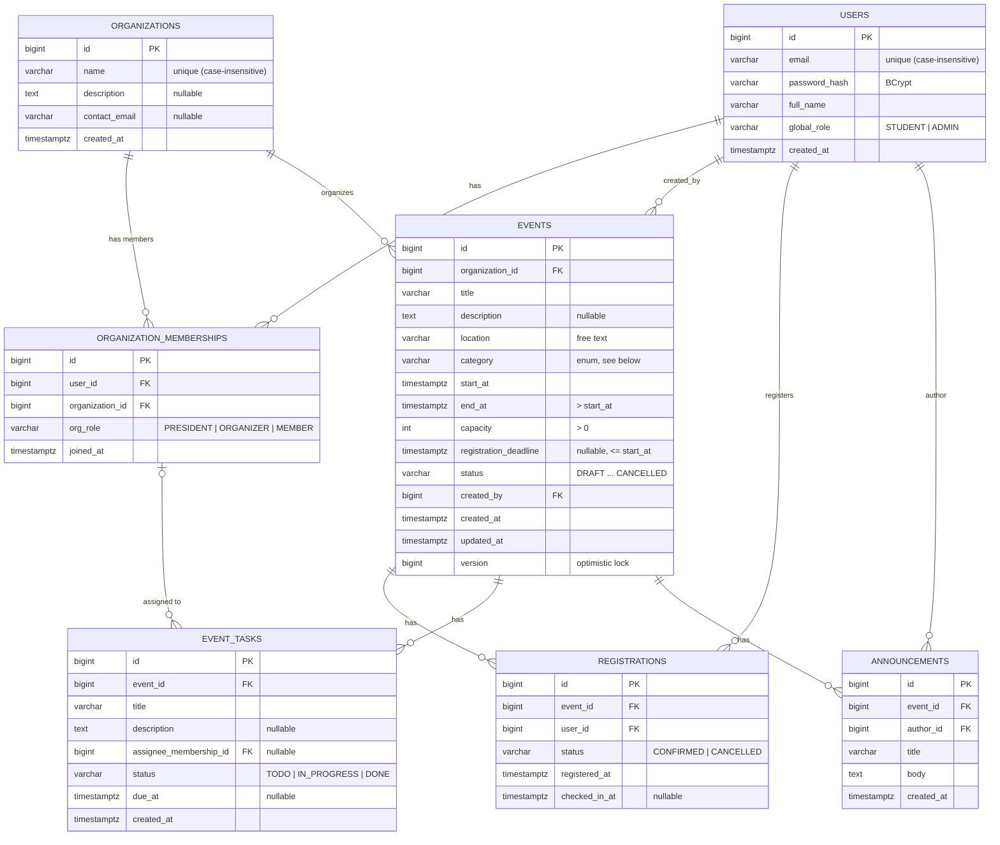

# Data model

The schema is created by Flyway (`backend/src/main/resources/db/migration/V1__initial_schema.sql`)
and validated by Hibernate at startup (`ddl-auto: validate`). JPA entities and Spring Data
repositories live in the `entity` / `repository` sub-packages of each feature package.

| Table | Entity | Feature package | Workflow |
|-------|--------|-----------------|----------|
| `users` | `User` | `user` | all |
| `organizations` | `Organization` | `organization` | W1 |
| `organization_memberships` | `OrganizationMembership` | `organization` | W1 |
| `events` | `Event` | `event` | W2, W3 |
| `registrations` | `Registration` | `registration` | W4 |
| `event_tasks` | `EventTask` | `organizing` | W5 |
| `announcements` | `Announcement` | `organizing` | W5 |

## ER diagram

## Design decisions (agreed before implementation)

| # | Decision | Reason |
|---|----------|--------|
| D1 | **No waitlist.** A registration is `CONFIRMED` or `CANCELLED`; when an event is full, new registrations are rejected. | Keeps W4 simple. A waitlist can be added later in a new migration that adds a `WAITLISTED` status. |
| D2 | **Location is free text** (`VARCHAR(255)`). | No workflow needs a location table, and a table would add joins. |
| D3 | **Category is a fixed enum**: `ACADEMIC, CAREER, CULTURAL, SOCIAL, SPORTS, VOLUNTEERING, WORKSHOP, OTHER`. | Easy to filter (W3). Adding a category takes a migration that changes `ck_events_category` plus a change to `EventCategory`. |
| D4 | **No hard deletes for events with registrations**; such events are cancelled (`status = CANCELLED`). Users and organizations are not hard-deleted either. | Keeps participation history and attendance. |
| D5 | **Dev seed** is a Flyway repeatable migration that only the dev profile loads (see below). | Easy to reproduce, and the seed cannot reach tests or production. |
| D6 | `BIGINT` identity ids, `TIMESTAMPTZ` columns mapped to `java.time.Instant`, and enums stored as `VARCHAR` + `CHECK` (`@Enumerated(STRING)`). | Timestamps carry an unambiguous time zone. Native PostgreSQL enum types are hard to change. |
| D11 | `events.version` column (`@Version`) | Optimistic locking: two organizers editing the same event cannot silently overwrite each other's changes. |

## Constraints and the business rules behind them

All constraints are named. A service can therefore map a `DataIntegrityViolationException`
to a clear 409 or 400 error by the constraint name.

### users
| Constraint | Rule |
|------------|------|
| `ux_users_email_lower` (unique index on `lower(email)`) | One account per email address, ignoring case: `Ana@ubb.ro` and `ana@ubb.ro` are the same account. Look users up with `findByEmailIgnoreCase`. |
| `ck_users_global_role` | Global role is `STUDENT` (the default) or `ADMIN`. Organization-level roles are kept in memberships, not here. |

### organizations
| Constraint | Rule |
|------------|------|
| `ux_organizations_name_lower` | Organization names are unique, ignoring case. |

### organization_memberships
| Constraint | Rule |
|------------|------|
| `uq_memberships_user_organization` | A user is a member of a given organization at most once and holds one role there. Changing the role updates the row instead of adding a new one. |
| `ck_memberships_org_role` | `PRESIDENT`, `ORGANIZER` or `MEMBER`. |
| `fk_memberships_user`, `fk_memberships_organization` (RESTRICT) | A user or organization that still has memberships cannot be deleted. |

### events
| Constraint | Rule |
|------------|------|
| `ck_events_capacity_positive` | `capacity > 0`. Every event has a hard participant limit (W4). |
| `ck_events_end_after_start` | `end_at > start_at`. |
| `ck_events_deadline_before_start` | `registration_deadline` is optional. When it is set, it must be `<= start_at`. NULL means registration stays open until the event starts. |
| `ck_events_category`, `ck_events_status` | Only the enum values are allowed. |
| `fk_events_organization`, `fk_events_created_by` (RESTRICT) | Every event belongs to exactly one organization and records who created it. |
| `ix_events_status_start_at`, `ix_events_start_at`, `ix_events_organization_id (organization_id, start_at)`, `ix_events_category` | Indexes for the W3 search: upcoming published events, an organization's events in chronological order, and filtering by category. |

Status lifecycle (W2): `DRAFT → PUBLISHED → REGISTRATION_CLOSED → ONGOING → COMPLETED`.
`CANCELLED` can be reached from any status except `COMPLETED`.

### registrations
| Constraint | Rule |
|------------|------|
| `ux_registrations_confirmed_once` (partial unique index on `(event_id, user_id) WHERE status = 'CONFIRMED'`) | A user has **at most one confirmed registration** per event. Cancelled rows stay as history, so a user can cancel and register again, which creates a new row. |
| `ck_registrations_status` | `CONFIRMED` or `CANCELLED` (no waitlist, D1). |
| `ck_registrations_checkin_confirmed` | `checked_in_at` can only be set on a `CONFIRMED` registration. A cancelled registration cannot be checked in. |
| `fk_registrations_event` (**RESTRICT**) | An event that has registrations **cannot be hard-deleted** (D4). Set its status to `CANCELLED` instead. |
| `fk_registrations_user` (RESTRICT) | A user who has registrations cannot be deleted. |

### event_tasks
| Constraint | Rule |
|------------|------|
| `fk_event_tasks_event` (CASCADE) | Tasks belong to their event. Deleting an event with no registrations, for example a DRAFT, also deletes its tasks. |
| `fk_event_tasks_assignee` (SET NULL) | The assignee is an organization **membership**, not a user. Removing someone from the organization deletes the membership and leaves their tasks unassigned. |
| `ck_event_tasks_status` | `TODO` (default), `IN_PROGRESS` or `DONE`. |

### announcements
| Constraint | Rule |
|------------|------|
| `fk_announcements_event` (CASCADE) | Announcements belong to their event. They are deleted with it, which can only happen to an event without registrations. |
| `fk_announcements_author` (RESTRICT) | The author is stored as a user. This keeps the author even if they later leave the organization. |

## Delete policy (summary)

| Parent deleted | Effect |
|----------------|--------|
| user | blocked while the user has memberships, events, registrations or announcements |
| organization | blocked while it has memberships or events |
| event **with registrations** | **blocked**: use `status = CANCELLED` |
| event without registrations | its tasks and announcements are deleted too |
| membership | tasks assigned to it become unassigned |

## Rules enforced in the service layer (not in the database)

The rules below span several rows or tables. CHECK constraints can't express them cleanly, so the services must enforce them, inside `@Transactional` methods:

1. **Capacity:** the number of `CONFIRMED` registrations must be `<= events.capacity`. To avoid
   overbooking when requests run at the same time, the registration service locks the event row
   (`SELECT ... FOR UPDATE` or `@Lock(PESSIMISTIC_WRITE)`), then counts with
   `countByEventIdAndStatus` and inserts.
2. **Registration window:** new registrations are allowed only while the event is `PUBLISHED`
   and `now() <= coalesce(registration_deadline, start_at)`.
3. **Task assignee:** the assignee's membership must belong to the event's organization.
4. **Status transitions** follow the lifecycle above and must agree with the dates. For example,
   `COMPLETED` only after `end_at`.
5. **Check-in** is done only by organizers of the event's organization, and only for a
   `CONFIRMED` registration. The database also enforces the "confirmed only" part.
6. **Permissions:** what PRESIDENT, ORGANIZER, MEMBER and ADMIN may do is decided in the services and security layer.

## Dev seed data

`backend/src/main/resources/db/seed-dev/R__dev_seed.sql` is a Flyway **repeatable** migration.

- Its folder, `classpath:db/seed-dev`, is added to `spring.flyway.locations` **only** in
  `application-dev.yml`. The base config and the `test` profile include only `db/migration`, so the seed
  never runs in tests or production.
- Flyway re-applies the seed whenever the file changes. Every insert is idempotent
  (`ON CONFLICT DO NOTHING` / `NOT EXISTS`), and rows are found by natural keys such as email,
  organization name and event title.
- Event dates are relative to `now()` at the time the seed is applied, so each status looks realistic.
  To refresh them, reset the dev database: `docker compose down -v && docker compose up -d postgres`
  (or `docker compose up --build` for the whole Dockerized stack).
- Note: once the seed has been applied, the dev database must always be started with the `dev` profile.
  Otherwise Flyway validation reports the applied `R__dev_seed` migration as missing.
  The backend container in `docker-compose.yml` pins the `dev` profile and the seed location for
  exactly this reason (they cannot be overridden from `.env`).

All seeded accounts have the password **`password`**:

| Email | Global role | Organization role |
|-------|-------------|-------------------|
| admin@ubbevents.ro | ADMIN | – |
| ana.popescu@stud.ubbcluj.ro | STUDENT | PRESIDENT of UBB Computer Science Society |
| mihai.ionescu@stud.ubbcluj.ro | STUDENT | PRESIDENT of UBB Theatre Club |
| elena.marin@stud.ubbcluj.ro | STUDENT | ORGANIZER in UBB Computer Science Society |
| radu.pop@stud.ubbcluj.ro | STUDENT | ORGANIZER in UBB Theatre Club |
| ioana.rusu@stud.ubbcluj.ro | STUDENT | MEMBER of UBB Computer Science Society |
| andrei.toma@stud.ubbcluj.ro | STUDENT | – |
| maria.dobre@stud.ubbcluj.ro | STUDENT | MEMBER of UBB Theatre Club |

Seeded events (one per status):

| Event | Organization | Status | Capacity | Notes |
|-------|--------------|--------|----------|-------|
| Spring Hackathon 2027 | CS Society | DRAFT | 100 | +60 days |
| Intro to Spring Boot Workshop | CS Society | PUBLISHED | 30 | 2 confirmed, 1 cancelled; 3 tasks; 1 announcement |
| Improv Night | Theatre Club | PUBLISHED | 50 | 2 confirmed; 1 task; no deadline |
| Tech Career Fair Prep | CS Society | REGISTRATION_CLOSED | 3 | full (3/3), deadline passed |
| Shakespeare Reading Marathon | Theatre Club | ONGOING | 40 | started 1h ago; 1 of 2 checked in |
| Campus Cleanup Day | CS Society | COMPLETED | 25 | 2 of 3 checked in |
| Board Games Evening | Theatre Club | CANCELLED | 20 | 1 cancelled registration; cancellation announcement |
