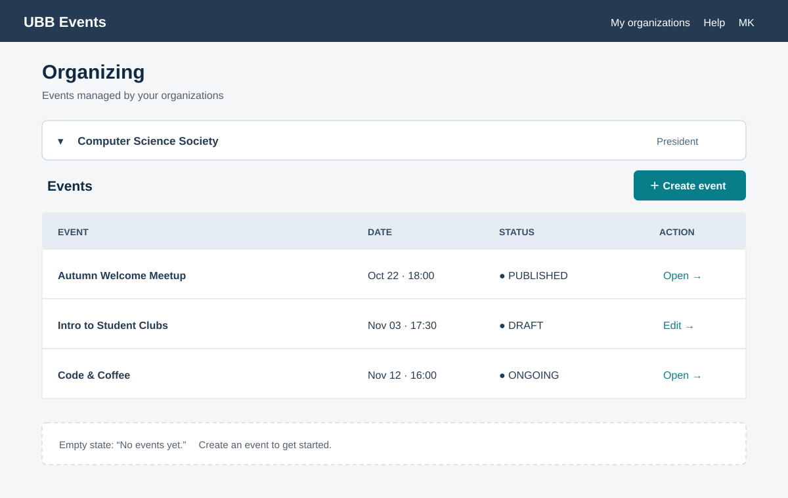
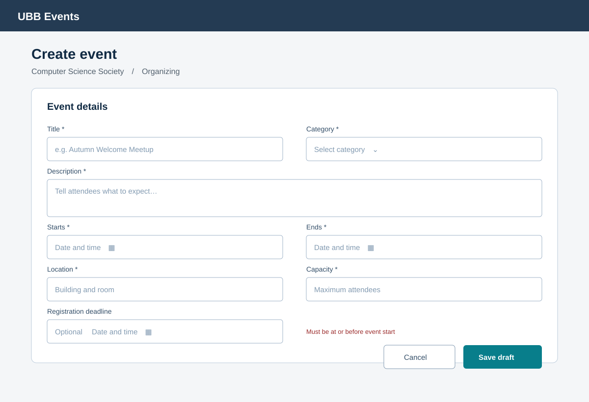
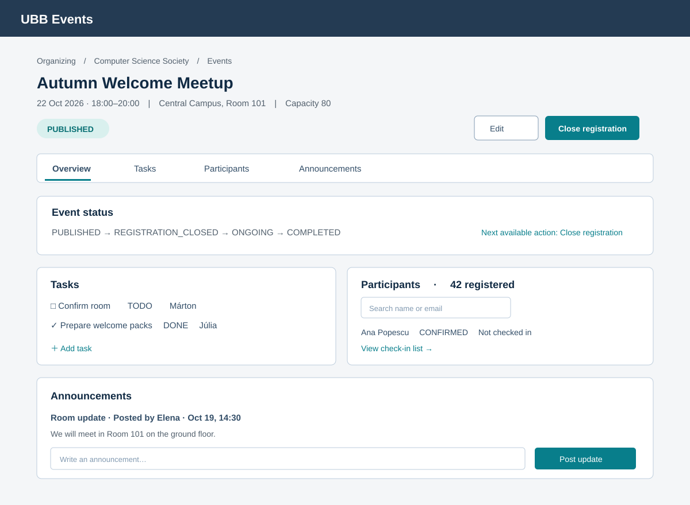
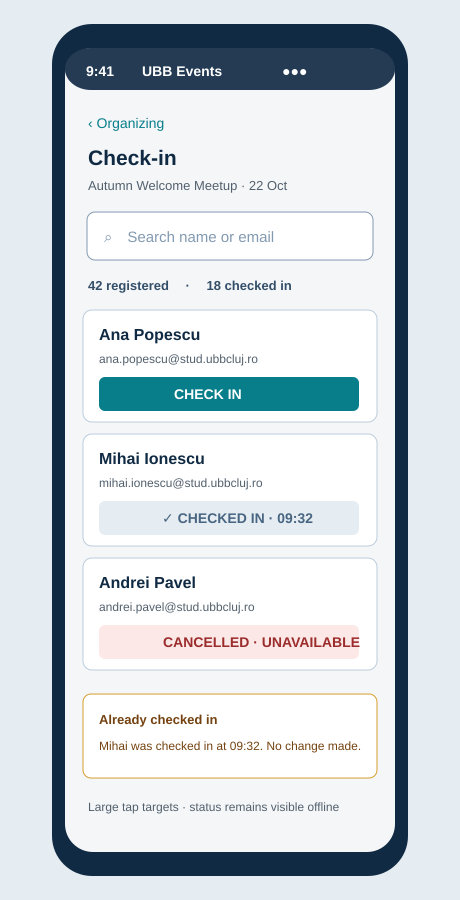
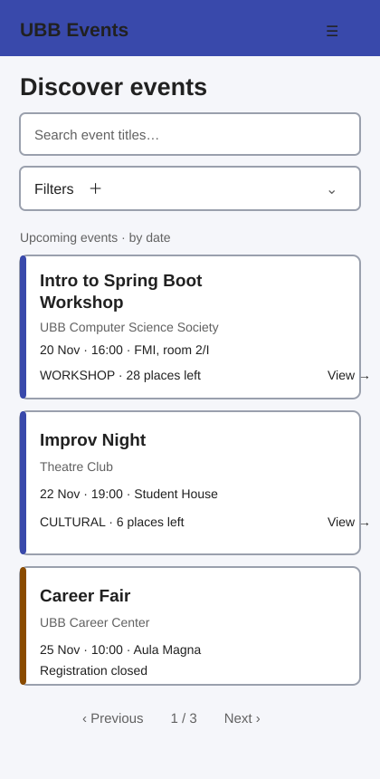
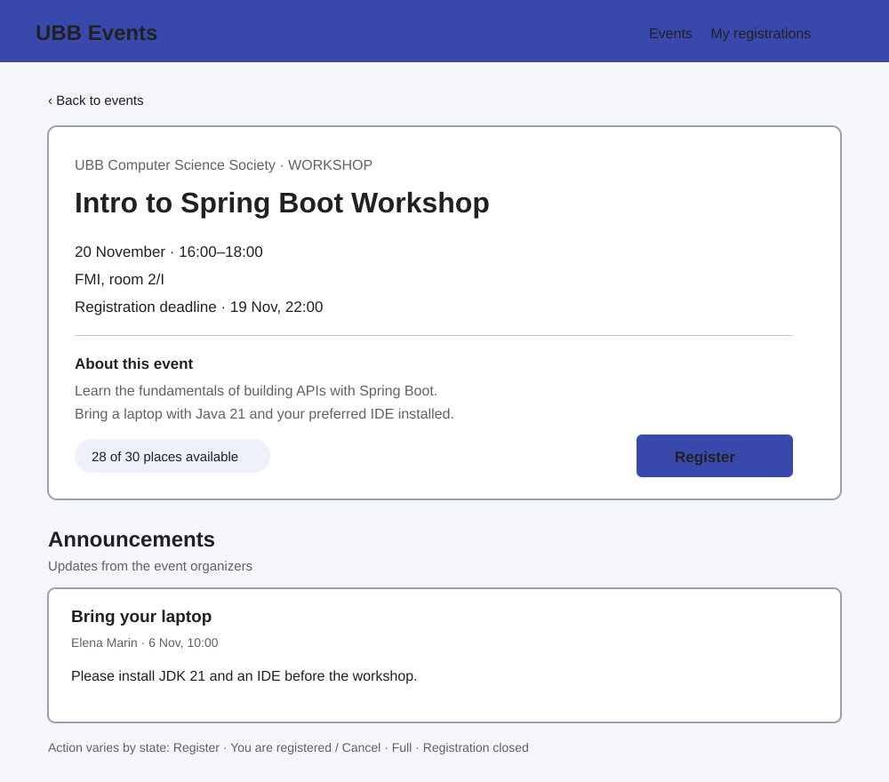

# Wireframes

Low-fidelity screen concepts for the UBB student organization event-management application.
These diagrams describe the intended information hierarchy and interactions; they are not
final visual specifications.

## Organizer screens

### 1. Organizing: events from my organizations

Shows the organizer's organizations and their events, with status, date, and clear actions to
open or create an event. A first-use empty state explains that no events exist and offers
“Create event.” Loading and failure states keep the page context and provide retry. **Use case:**
[UC-20](../midterm/04-use-cases.md#uc-20-create-a-draft-event), [UC-21](../midterm/04-use-cases.md#uc-21-edit-an-event),
[UC-22](../midterm/04-use-cases.md#uc-22-publish-an-event), [UC-23](../midterm/04-use-cases.md#uc-23-close-registration--start--complete-an-event),
[UC-24](../midterm/04-use-cases.md#uc-24-cancel-an-event).

### 2. Create/edit event

The form groups event details, schedule, venue, capacity, and registration deadline. Required
fields are marked, date constraints are visible, and inline validation leaves entered values
intact. Save as draft and cancel are separated from lifecycle actions; editing is available only
when the event status permits it. **Use cases:** [UC-20](../midterm/04-use-cases.md#uc-20-create-a-draft-event),
[UC-21](../midterm/04-use-cases.md#uc-21-edit-an-event).

### 3. Organizer event page

The event header keeps its status and permitted lifecycle actions visible. Tasks, Participants,
and Announcements are distinct sections on one page. Tasks show assignment and progress;
participants show registration and check-in state with a status filter; announcements show the
newest updates and a composer when posting is allowed. Empty/loading/error states belong to each
section so one failed panel does not obscure the others. **Use cases:** [UC-20](../midterm/04-use-cases.md#uc-20-create-a-draft-event),
[UC-21](../midterm/04-use-cases.md#uc-21-edit-an-event), [UC-22](../midterm/04-use-cases.md#uc-22-publish-an-event),
[UC-23](../midterm/04-use-cases.md#uc-23-close-registration--start--complete-an-event),
[UC-24](../midterm/04-use-cases.md#uc-24-cancel-an-event), [UC-50](../midterm/04-use-cases.md#uc-50-manage-organizer-tasks),
[UC-51](../midterm/04-use-cases.md#uc-51-view-the-participant-list), [UC-53](../midterm/04-use-cases.md#uc-53-post-and-read-announcements),
[UC-54](../midterm/04-use-cases.md#uc-54-read-announcements-of-my-events).

### 4. Mobile check-in at the door

Designed for one-handed use at a busy entrance: a compact event summary, large search field,
clear attendee rows, and a high-contrast full-width check-in action. Search accepts a name or
email. After success, the row changes to “Checked in” with its time and the action is disabled;
cancelled registrations cannot be checked in. An already checked-in result is shown as a
non-destructive status, and the list can be refreshed if connectivity returns. **Use cases:**
[UC-51](../midterm/04-use-cases.md#uc-51-view-the-participant-list),
[UC-52](../midterm/04-use-cases.md#uc-52-check-in-a-participant).

---

**Author:** Portik Márk-Krisztián. **Ticket:** T-42 / [issue #50](https://github.com/PatriciuMina/GenAI-Project/issues/50).
Low-fidelity student screen layouts for the mid-term MVP. The layouts use the UBB Events
palette as a light visual cue; spacing and hierarchy are illustrative, not final specifications.

## Student screens

### Events list — desktop

- **Use cases:** UC-30 Browse upcoming events; UC-31 Search and filter events.
- **API:** `GET /api/v1/events` (T-16). Search and filters map to `q`, `category`,
  `organizationId`, `from`, and `to`; pagination uses `page` and `size`. Cards show
  `title`, `organizationName`, `startAt`, `location`, `category`, `freePlaces`, and `status`
  from each `EventResponse`. Page controls use `page`, `totalPages`, and `totalElements`.
- No matches show an empty state; loading and request errors occupy the results area.

### Events list — mobile

- **Use cases:** UC-30 Browse upcoming events; UC-31 Search and filter events.
- **API:** Same T-16 endpoint and fields as the desktop list. Filters collapse into a
  full-width filter panel, while event cards and pagination stack vertically.

### Event details

- **Use cases:** UC-32 View event details; UC-41 Register for an event; UC-42 Cancel my
  registration; UC-53 Post and read announcements; UC-54 Read announcements of my events.
- **Event API:** `GET /api/v1/events/{id}` (T-18). The page uses `title`, `organizationName`,
  `category`, `startAt`, `endAt`, `location`, `description`, `capacity`,
  `registrationDeadline`, `status`, `confirmedCount`, and `freePlaces` from `EventResponse`.
  A null `registrationDeadline` is presented as registration open until the event starts.
- **Registration API:** `POST /api/v1/events/{eventId}/registrations` creates a registration
  (T-21); the user's registration state comes from `GET /api/v1/users/me/registrations` (T-23),
  including `eventId` and `status`. The action area represents Register, registered/cancel,
  full, and registration-closed states; T-22 provides cancellation.
- **Announcements API:** `GET /api/v1/events/{eventId}/announcements` (T-30) supplies
  `title`, `body`, `authorName`, and `createdAt`. The API allows reads for organization
  members and confirmed or cancelled participants; an empty list has an announcements
  empty state.

### My registrations

- **Use cases:** UC-40 View my registrations; UC-42 Cancel my registration.
- **API:** `GET /api/v1/users/me/registrations` (T-23) returns the caller's registrations.
  Rows use `eventTitle`, `eventStartAt`, `eventLocation`, `eventStatus`, `status`,
  `registeredAt`, and `checkedInAt`. Event links use `eventId`; cancellation is T-22.
- Separate upcoming and past/cancelled groupings make the registration status visible.
  An empty response displays an empty state and a route back to Events.

---

Designed and documented by **Portik Márk-Krisztián**.
