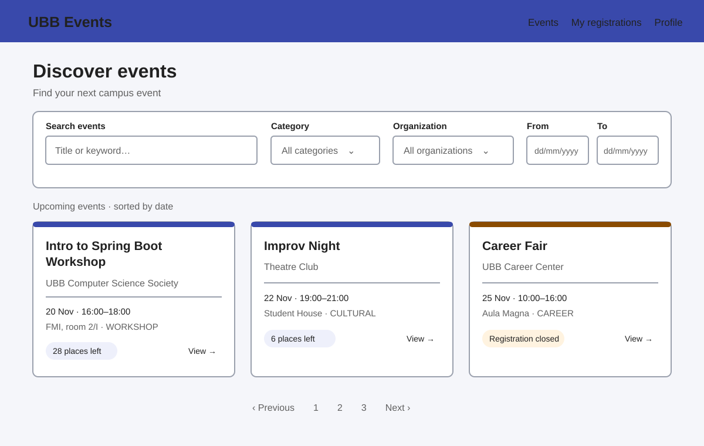
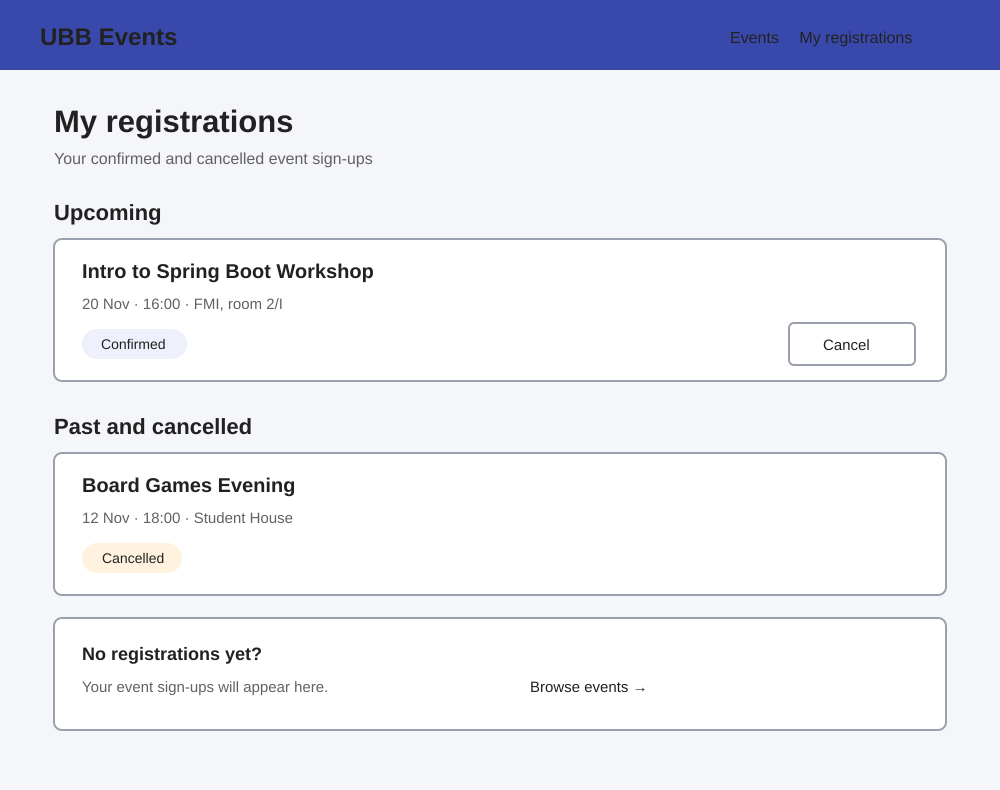

# Wireframes

Low-fidelity student screen layouts for the mid-term MVP. The layouts use the UBB Events
palette as a light visual cue; spacing and hierarchy are illustrative, not final specifications.

## Student screens

### Events list — desktop

- **Use cases:** UC-30 Browse upcoming events; UC-31 Search and filter events.
- **API:** `GET /api/v1/events` (T-16). Search and filters map to `q`, `category`,
  `organizationId`, `from`, and `to`; pagination uses `page` and `size`. Cards show
  `title`, `organizationName`, `startAt`, `location`, `category`, `freePlaces`, and `status`
  from each `EventResponse`. Page controls use `page`, `totalPages`, and `totalElements`.
- No matches show an empty state; loading and request errors occupy the results area.

### Events list — mobile

- **Use cases:** UC-30 Browse upcoming events; UC-31 Search and filter events.
- **API:** Same T-16 endpoint and fields as the desktop list. Filters collapse into a
  full-width filter panel, while event cards and pagination stack vertically.

### Event details

- **Use cases:** UC-32 View event details; UC-41 Register for an event; UC-42 Cancel my
  registration; UC-53 Post and read announcements; UC-54 Read announcements of my events.
- **Event API:** `GET /api/v1/events/{id}` (T-18). The page uses `title`, `organizationName`,
  `category`, `startAt`, `endAt`, `location`, `description`, `capacity`,
  `registrationDeadline`, `status`, `confirmedCount`, and `freePlaces` from `EventResponse`.
  A null `registrationDeadline` is presented as registration open until the event starts.
- **Registration API:** `POST /api/v1/events/{eventId}/registrations` creates a registration
  (T-21); the user's registration state comes from `GET /api/v1/users/me/registrations` (T-23),
  including `eventId` and `status`. The action area represents Register, registered/cancel,
  full, and registration-closed states; T-22 provides cancellation.
- **Announcements API:** `GET /api/v1/events/{eventId}/announcements` (T-30) supplies
  `title`, `body`, `authorName`, and `createdAt`. The API allows reads for organization
  members and confirmed or cancelled participants; an empty list has an announcements
  empty state.

### My registrations

- **Use cases:** UC-40 View my registrations; UC-42 Cancel my registration.
- **API:** `GET /api/v1/users/me/registrations` (T-23) returns the caller's registrations.
  Rows use `eventTitle`, `eventStartAt`, `eventLocation`, `eventStatus`, `status`,
  `registeredAt`, and `checkedInAt`. Event links use `eventId`; cancellation is T-22.
- Separate upcoming and past/cancelled groupings make the registration status visible.
  An empty response displays an empty state and a route back to Events.

---

Designed and documented by **Portik Márk-Krisztián**.
