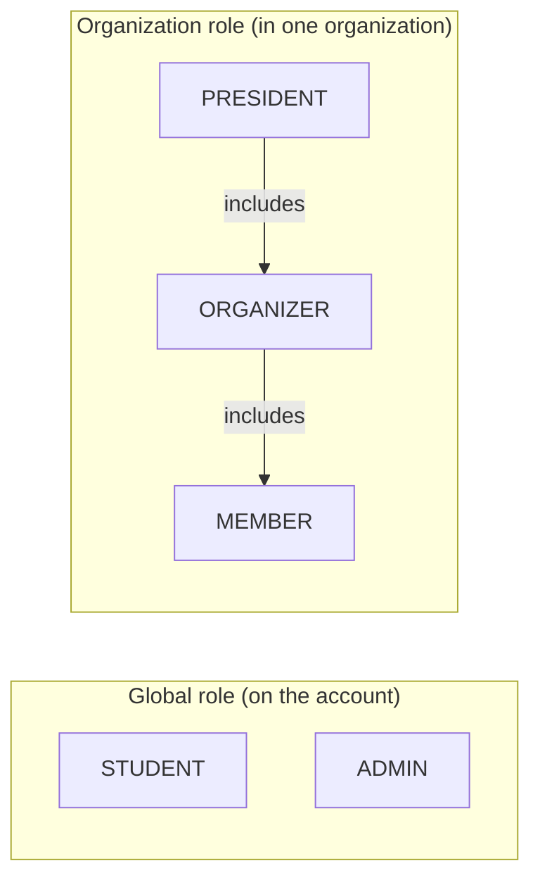

# 3. Actors and roles

Part **B.3** of the mid-term deliverable. Index: [README](README.md).

**Source of truth.** Permissions are decided in code, not in this document. When the doc
and the code disagree, the code wins and the doc must be fixed (or an issue opened).
- `backend/src/main/java/ro/ubb/events/config/SecurityConfig.java`: public vs.
  authenticated endpoints; global roles become `ROLE_STUDENT` / `ROLE_ADMIN`.
- `backend/src/main/java/ro/ubb/events/organization/service/OrgPermissionService.java`:
  organization-level checks `isMember`, `isOrganizer`, `isPresident`
  (hierarchy PRESIDENT ⊃ ORGANIZER ⊃ MEMBER; a global ADMIN gets **no** automatic org rights).
- `@PreAuthorize(...)` annotations on controllers/services (search the code for `@PreAuthorize`).

---

## 3.1 Actors

**Ticket:** `docs: describe actors` · **Points:** 1

**What to write**
Describe each kind of user of the system and the external systems it talks to (if any).
Explain the two levels of roles: the **global** role on the account (STUDENT, ADMIN) and the
**organization** role inside one organization (MEMBER, ORGANIZER, PRESIDENT). Note that a
student can have different roles in different organizations, and that a visitor (not
logged in) is also an actor.

**Where to find the information**
- `backend/.../user/entity/GlobalRole.java`, `organization/entity/OrganizationRole.java`
- `docs/data-model.md` → `users`, `organization_memberships`; seed accounts table (real examples of each role)
- `docs/architecture/ADR-003-jwt-auth-spring-security.md` → "Implementation notes" (who can register, ADMIN only from seed)
- `01-problem-statement.md` → stakeholders

**Format**
Table: `Actor | Kind (global / org role / external) | Description | Example seed account`. 6–8 rows.
Optionally a small Mermaid diagram showing the role hierarchy.

There are two levels of roles. The **global role** is stored on the account and is `STUDENT` or `ADMIN`; every account has exactly one. The **organization role** is stored in a membership and is `MEMBER`, `ORGANIZER` or `PRESIDENT`; it belongs to one organization, so the same student can be a president in one organization, a member in another and have no role in a third. A visitor, who is not logged in, is also an actor. The system has no external systems it talks to: it issues its own tokens (no external identity provider) and sends no email (`docs/architecture/ADR-003-jwt-auth-spring-security.md`, section 1.4 of `01-problem-statement.md`).

| Actor | Kind | Description | Example seed account |
|-------|------|-------------|----------------------|
| Visitor | Not logged in | Anyone who has not logged in. Can only create an account and log in | none |
| Student | Global role `STUDENT` | Every registered account starts as a student. Can browse organizations, open events, register for events and see their registrations. A student who has registered for an event is its participant, which is not a separate role | andrei.toma@stud.ubbcluj.ro (no organization role) |
| Administrator | Global role `ADMIN` | Platform administrator, created only from the seed. Creates organizations and appoints their president, and can see, add and remove members of any organization. Has no organizer or president rights by being an administrator | admin@ubbevents.ro |
| Member | Organization role `MEMBER` | Belongs to an organization. Sees the list of its members and the announcements of its events | ioana.rusu@stud.ubbcluj.ro (UBB Computer Science Society) |
| Organizer | Organization role `ORGANIZER` | Member who prepares the organization's events: creates and edits events, manages tasks, sees the participants and posts announcements | elena.marin@stud.ubbcluj.ro (UBB Computer Science Society) |
| President | Organization role `PRESIDENT` | Leads the organization. Can do everything an organizer can, and adds and removes the organization's members | ana.popescu@stud.ubbcluj.ro (UBB Computer Science Society) |

An organization role includes the roles below it: a president can do what an organizer can, and an organizer what a member can (`OrgPermissionService`). The global role is separate from this: an administrator gets no organization rights automatically.

**Done when**
- [ ] Both role levels are explained with one sentence each.
- [ ] Every value of `GlobalRole` and `OrganizationRole` appears, plus Visitor.
- [ ] Consistent with stakeholders in `01-problem-statement.md`.

**Open items for the team**
- What each actor may do, action by action, is the permission matrix (section 3.2); the descriptions above only summarise it.

---

## 3.2 Permission matrix

**Ticket:** `docs: permission matrix` · **Points:** 2

**What to write**
One row per action (grouped by workflow W1–W5 plus accounts/admin), one column per actor.
Mark what each actor may do. "Organizer" etc. always means *of the organization that owns
the event*. Add the **Enforced by** column: the exact check in code (or `planned` if the
endpoint does not exist yet). The actions should match the use cases in `04-use-cases.md`.

**Where to find the information**
- `SecurityConfig.java`, `OrgPermissionService.java`, `@PreAuthorize` annotations (see top of file)
- `backend/src/test/java/ro/ubb/events/organization/OrgPermissionServiceTest.java`,
  `OrgPermissionPreAuthorizeIntegrationTest.java` (show the expected behaviour)
- `docs/dev-guide/how-to-add-a-feature.md` §5 "Security – who may call the endpoint"
- `docs/data-model.md` → "Rules enforced in the service layer" (rule 6)
- `02-requirements.md` (FR IDs)

**Format**
Table. Legend: ✅ allowed · ❌ not allowed · 🔸 only own (e.g. own registration). 15–30 rows.
Columns: `Action | FR | Visitor | Student | Member | Organizer | President | Admin | Enforced by`.

> **Example – replace:**
>
> | Action | FR | Visitor | Student | Member | Organizer | President | Admin | Enforced by |
> |--------|----|---------|---------|--------|-----------|-----------|-------|-------------|
> | List organizations | FR-W1-01 | ❌ | ✅ | ✅ | ✅ | ✅ | ✅ | `SecurityConfig` (authenticated) |

**Done when**
- [ ] Every row has an FR ID and an "Enforced by" value (code reference or `planned`).
- [ ] Rows marked implemented were checked against the code/tests.
- [ ] ADMIN rights inside organizations are stated explicitly (not assumed).
- [ ] Reviewed by the teammate who owns `SecurityConfig` / `OrgPermissionService`.

> TODO (team): permission matrix here.
