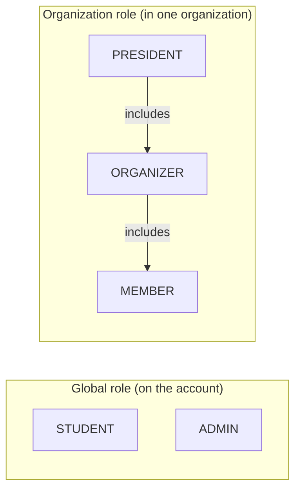

# 3. Actors and roles

Part **B.3** of the mid-term deliverable. Index: [README](README.md).

**Source of truth.** Permissions are decided in code, not in this document. When the doc
and the code disagree, the code wins and the doc must be fixed (or an issue opened).
- `backend/src/main/java/ro/ubb/events/config/SecurityConfig.java`: public vs.
  authenticated endpoints; global roles become `ROLE_STUDENT` / `ROLE_ADMIN`.
- `backend/src/main/java/ro/ubb/events/organization/service/OrgPermissionService.java`:
  organization-level checks `isMember`, `isOrganizer`, `isPresident`
  (hierarchy PRESIDENT ⊃ ORGANIZER ⊃ MEMBER; a global ADMIN gets **no** automatic org rights).
- `@PreAuthorize(...)` annotations on controllers/services (search the code for `@PreAuthorize`).

---

## 3.1 Actors

There are two levels of roles. The **global role** is stored on the account and is `STUDENT` or `ADMIN`; every account has exactly one. The **organization role** is stored in a membership and is `MEMBER`, `ORGANIZER` or `PRESIDENT`; it belongs to one organization, so the same student can be a president in one organization, a member in another and have no role in a third. A visitor, who is not logged in, is also an actor. The system has no external systems it talks to: it issues its own tokens (no external identity provider) and sends no email (`docs/architecture/ADR-003-jwt-auth-spring-security.md`, section 1.4 of `01-problem-statement.md`).

| Actor | Kind | Description | Example seed account |
|-------|------|-------------|----------------------|
| Visitor | Not logged in | Anyone who has not logged in. Can only create an account and log in | none |
| Student | Global role `STUDENT` | Every registered account starts as a student. Can browse organizations, open events, register for events and see their registrations. A student who has registered for an event is its participant, which is not a separate role | andrei.toma@stud.ubbcluj.ro (no organization role) |
| Administrator | Global role `ADMIN` | Platform administrator, created only from the seed. Creates organizations and appoints their president, and can see, add and remove members of any organization. Has no organizer or president rights by being an administrator | admin@ubbevents.ro |
| Member | Organization role `MEMBER` | Belongs to an organization. Sees the list of its members and the announcements of its events | ioana.rusu@stud.ubbcluj.ro (UBB Computer Science Society) |
| Organizer | Organization role `ORGANIZER` | Member who prepares the organization's events: creates and edits events, manages tasks, sees the participants and posts announcements | elena.marin@stud.ubbcluj.ro (UBB Computer Science Society) |
| President | Organization role `PRESIDENT` | Leads the organization. Can do everything an organizer can, and adds and removes the organization's members | ana.popescu@stud.ubbcluj.ro (UBB Computer Science Society) |

An organization role includes the roles below it: a president can do what an organizer can, and an organizer what a member can (`OrgPermissionService`). The global role is separate from this: an administrator gets no organization rights automatically.

---

## 3.2 Permission matrix

Legend: ✅ allowed · ❌ not allowed · 🔸 only own (e.g. own registration).

| Action | FR | Visitor | Student | Member | Organizer | President | Admin | Enforced by |
|--------|----|---------|---------|--------|-----------|-----------|-------|-------------|
| Create account | FR-AUTH-01 | ✅ | ❌ | ❌ | ❌ | ❌ | ❌ | `SecurityConfig` (`.requestMatchers(HttpMethod.POST, PUBLIC_POST_PATHS).permitAll()`) |
| Log in | FR-AUTH-03 | ✅ | ❌ | ❌ | ❌ | ❌ | ❌ | `SecurityConfig` (`PUBLIC_POST_PATHS` includes `/api/v1/auth/login`) |
| View my account | FR-AUTH-05 | ❌ | ✅ | ✅ | ✅ | ✅ | ✅ | `SecurityConfig` (authenticated) + `UserController` uses `AuthenticatedUser me` |
| Create organization | FR-ADM-02, FR-W1-03 | ❌ | ❌ | ❌ | ❌ | ❌ | ✅ | `@PreAuthorize("hasRole('ADMIN')")` on `OrganizationController.create`; `PermissionMatrixIntegrationTest.createOrganizationPermissionMatrix` |
| List organizations | FR-W1-01 | ❌ | ✅ | ✅ | ✅ | ✅ | ✅ | `SecurityConfig` (authenticated) |
| View my memberships | FR-W1-02 | ❌ | ✅ | ✅ | ✅ | ✅ | ✅ | `SecurityConfig` (authenticated); `MyMembershipsController` filters by the caller |
| View member list | FR-W1-04 | ❌ | ❌ | ✅ | ✅ | ✅ | ✅ | `@PreAuthorize("hasRole('ADMIN') or @orgPermissions.isMember(principal.id, #orgId)")` |
| Add member | FR-W1-05 | ❌ | ❌ | ❌ | ❌ | ✅ | ✅ | `@PreAuthorize("hasRole('ADMIN') or @orgPermissions.isPresident(principal.id, #orgId)")`; `PermissionMatrixIntegrationTest.addMemberPermissionMatrix` |
| Remove member | FR-W1-06 | ❌ | ❌ | ❌ | ❌ | ✅ | ✅ | `@PreAuthorize("hasRole('ADMIN') or @orgPermissions.isPresident(principal.id, #orgId)")`; `PermissionMatrixIntegrationTest.removeMemberPermissionMatrix` |
| Edit organization details | FR-W1-10 | ❌ | ❌ | ❌ | ❌ | ✅ | ❌ | `planned` |
| Change member role | FR-W1-08 | ❌ | ❌ | ❌ | ❌ | ✅ | ❌ | `planned` |
| Leave an organization | FR-W1-09 | ❌ | ❌ | ✅ | ✅ | ❌ | ❌ | `planned` |
| Create event for an organization | FR-W2-01 | ❌ | ❌ | ❌ | ✅ | ✅ | ❌ | `@PreAuthorize("@orgPermissions.isOrganizer(principal.id, #orgId)")` on `EventController.create`; `PermissionMatrixIntegrationTest.createEventPermissionMatrix` |
| Edit a draft or published event | FR-W2-03 | ❌ | ❌ | ❌ | ✅ | ✅ | ❌ | `EventService.update`: `orgPermissionService.isOrganizer(userId, event.getOrganization().getId())` |
| Open a DRAFT event | FR-W2-04, FR-W3-05 | ❌ | ❌ | ❌ | ✅ | ✅ | ❌ | `EventService.getById`: if `status == DRAFT` and not organizer, throw `NotFoundException` |
| Change event lifecycle status | FR-W2-05–10 | ❌ | ❌ | ❌ | ✅ | ✅ | ❌ | `EventService.changeStatus(...)` checks `orgPermissionService.isOrganizer(...)`; `PermissionMatrixIntegrationTest.changeStatusPermissionMatrix` |
| Search / browse upcoming events | FR-W3-01–03 | ❌ | ✅ | ✅ | ✅ | ✅ | ✅ | `EventService.search(...)` with authenticated access and status filters |
| Open event details (non-draft) | FR-W3-04, FR-W3-05 | ❌ | ✅ | ✅ | ✅ | ✅ | ✅ | `EventService.getById(...)` (DRAFT hidden from non-organizers; all other logged-in users can open visible events) |
| List an organization's events | FR-W3-06 | ❌ | ✅ | ✅ | ✅ | ✅ | ✅ | `EventService.findByOrganization(...)` (filters DRAFTs for non-organizers; endpoint exists) |
| Register for a published event | FR-W4-01–04 | ❌ | 🔸 | 🔸 | 🔸 | 🔸 | 🔸 | `RegistrationService.register(...)` (`PUBLISHED`, open window, no duplicate, capacity check) |
| Cancel my registration | FR-W4-05 | ❌ | 🔸 | 🔸 | 🔸 | 🔸 | 🔸 | `RegistrationService.cancelMyRegistration(...)`: only the caller's own CONFIRMED registration (`DELETE .../registrations/me`); `RegistrationCancelControllerIntegrationTest.onlyTheCallersOwnRegistrationIsCancelled` |
| View my registrations | FR-W4-07 | ❌ | 🔸 | 🔸 | 🔸 | 🔸 | 🔸 | `RegistrationController.listMine(...)` using caller identity |
| View participant list | FR-W5-01 | ❌ | ❌ | ❌ | ✅ | ✅ | ❌ | `RegistrationService.listParticipants(...)`: `orgPermissionService.isOrganizer(callerId, event.getOrganization().getId())` |
| Create task | FR-W5-02, FR-W5-03 | ❌ | ❌ | ❌ | ✅ | ✅ | ❌ | `TaskService.create(...)`: `loadEventForOrganizer(...)` + `ASSIGNEE_NOT_IN_ORGANIZATION` check; `PermissionMatrixIntegrationTest.createTaskPermissionMatrix` |
| List tasks | FR-W5-04 | ❌ | ❌ | ❌ | ✅ | ✅ | ❌ | `TaskService.list(...)`: `loadEventForOrganizer(...)` |
| Change task status / assignee | FR-W5-05 | ❌ | ❌ | ❌ | ✅ | ✅ | ❌ | `TaskService.update(...)`: `loadEventForOrganizer(...)` |
| Check in a participant | FR-W5-07 | ❌ | ❌ | ❌ | ✅ | ✅ | ❌ | `RegistrationService.checkIn(...)`: organizer check + `CHECK_IN_NOT_ALLOWED` / `ALREADY_CHECKED_IN` rules; `PermissionMatrixIntegrationTest.checkInPermissionMatrix` |
| Post announcement | FR-W5-08 | ❌ | ❌ | ❌ | ✅ | ✅ | ❌ | `AnnouncementService.create(...)`: `isOrganizer(...)`; rejects DRAFT or COMPLETED; `PermissionMatrixIntegrationTest.postAnnouncementPermissionMatrix` |
| Read announcements for an event | FR-W5-09 | ❌ | 🔸 | ✅ | ✅ | ✅ | ❌ | `AnnouncementService.list(...)`: `orgPermissionService.isMember(...) || registrationService.hasRegistration(...)` |
