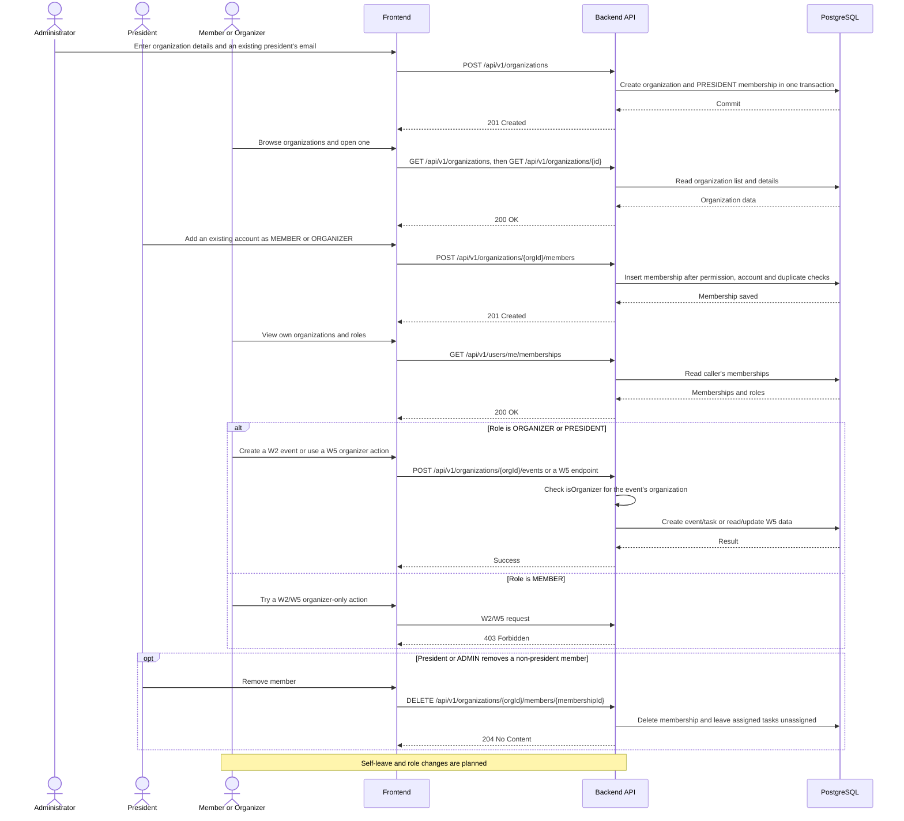
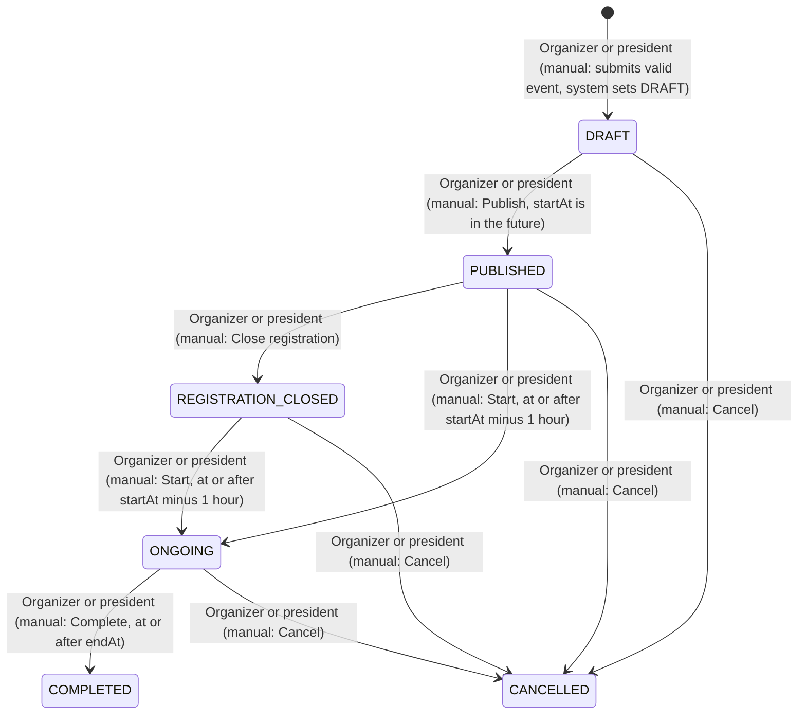
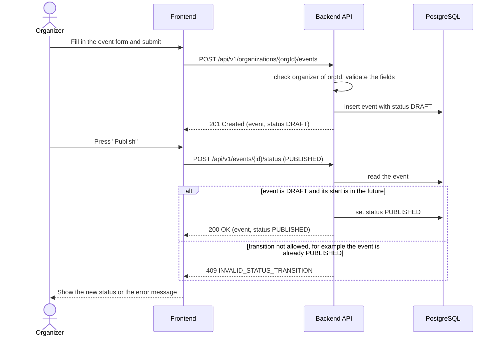
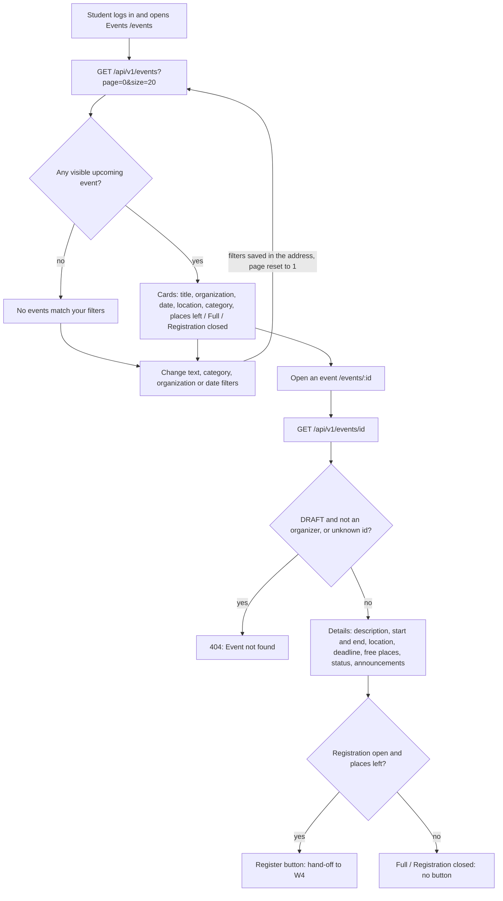
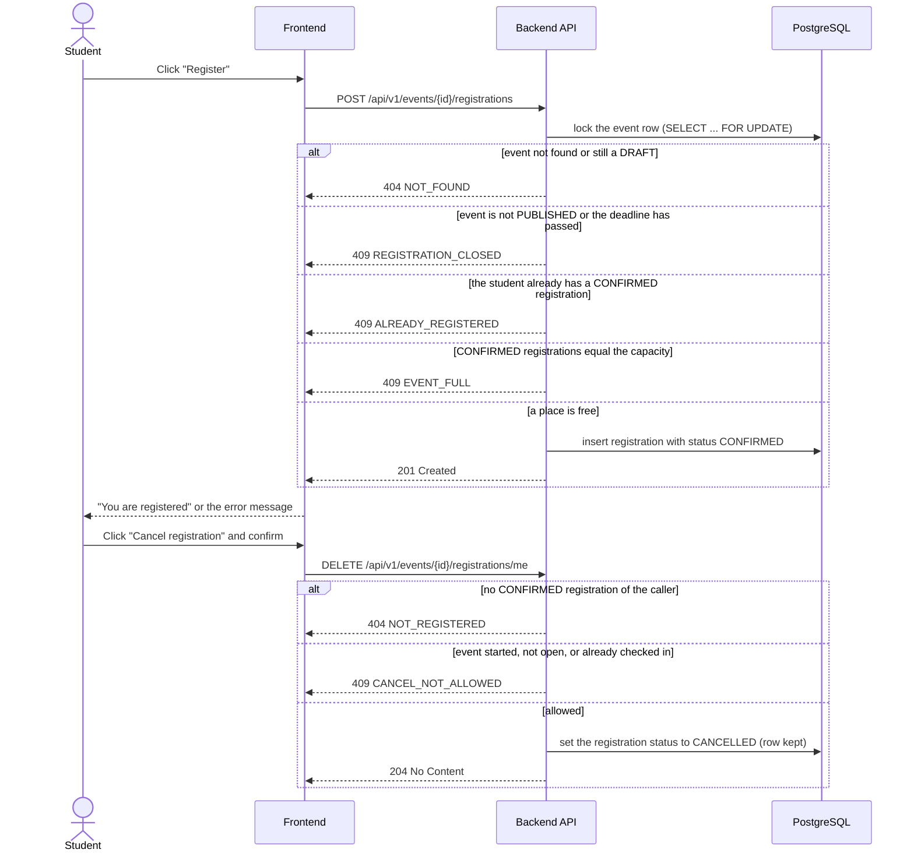
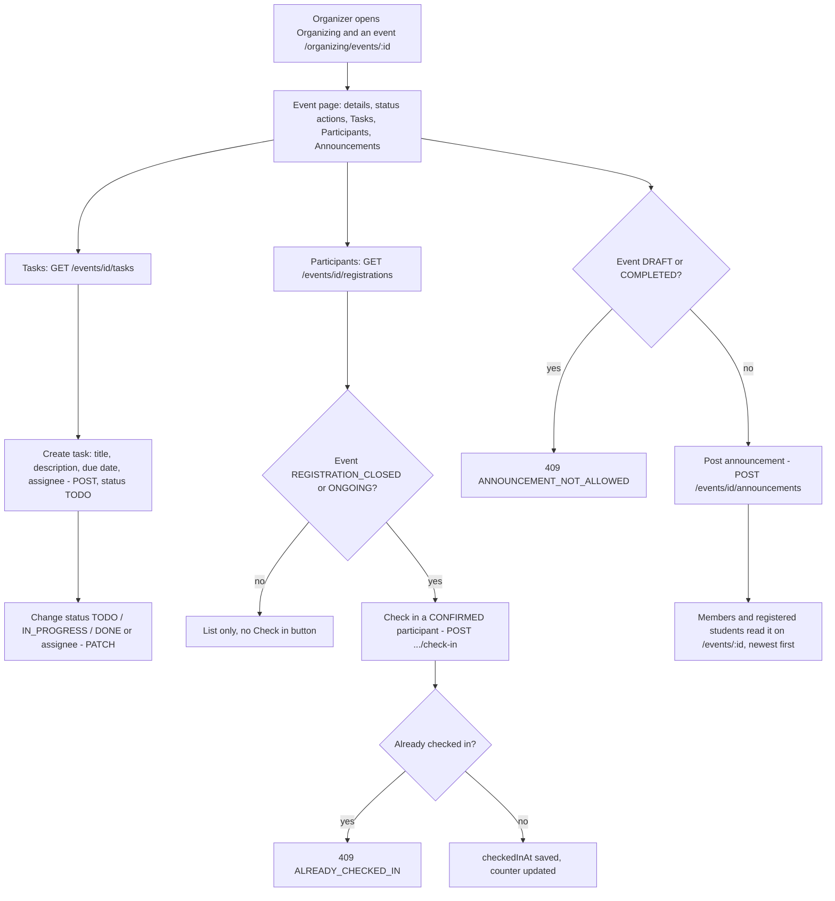

# 5. Main application workflows

Part **B.5** of the mid-term deliverable. Index: [README](README.md).

A *workflow* is the end-to-end path through the system for one goal, across UI, API and
database. Use cases (`04-use-cases.md`) describe single interactions; here you connect them.

---

## 5.1 W1 Organizations and membership

1. **Implemented — create:** An administrator opens **Admin** (`/admin`), enters an organization name and an existing account's email as its president, then submits. The frontend calls `POST /api/v1/organizations`.
2. **Implemented — appoint president:** The backend creates the organization and its `PRESIDENT` membership together in one transaction; the account must already exist.
3. **Implemented — list organizations:** A logged-in user opens **Organizations** (`/organizations`). The frontend calls `GET /api/v1/organizations` and displays the organizations sorted by name.
4. **Implemented — view organization:** The user opens an organization's details (`/organizations/{id}`); the frontend calls `GET /api/v1/organizations/{orgId}`. A logged-in member or an administrator can also see its members through `GET /api/v1/organizations/{orgId}/members`.
5. **Implemented — add members and assign initial roles:** The organization's president or an administrator submits an existing account's email and role (`MEMBER` or `ORGANIZER`) from the members section on `/organizations/{id}`. The frontend calls `POST /api/v1/organizations/{orgId}/members`; a student cannot join themself in the MVP.
6. **Implemented — see membership:** The added user sees the organization and their role in the app; the frontend loads `GET /api/v1/users/me/memberships`.
7. **Implemented — W2 access:** An `ORGANIZER` or `PRESIDENT` can create an event from
   `/organizing/events/new` with `POST /api/v1/organizations/{orgId}/events`; it starts as
   `DRAFT`. They can edit a DRAFT or PUBLISHED event from `/organizing/events/{id}/edit`
   with `PUT /api/v1/events/{id}`.
8. **Implemented — W5 access:** An `ORGANIZER` or `PRESIDENT` can list
   participants (`GET /api/v1/events/{eventId}/registrations`), create/list/update tasks
   (`POST /api/v1/events/{eventId}/tasks`, `GET /api/v1/events/{eventId}/tasks`,
   `PATCH /api/v1/events/{eventId}/tasks/{taskId}`), post announcements
   (`POST /api/v1/events/{eventId}/announcements`) and check in a participant
   (`POST /api/v1/events/{eventId}/registrations/{registrationId}/check-in`). The W5 screens
   are on the organizer event page `/organizing/events/{id}` (§5.5).
9. **Implemented — remove members; planned — leave or change role:** A president or administrator removes a non-president from `/organizations/{id}` with `DELETE /api/v1/organizations/{orgId}/members/{membershipId}`. A member leaving themself and changing a membership between `MEMBER` and `ORGANIZER` are planned; how a president leaves or is replaced is still open.

**Business rules**
- Only a global `ADMIN` can create an organization. The president is an existing account, and the organization plus its president membership are created together; organization names are unique ignoring case. (`OrganizationController`, `OrganizationService`; `docs/data-model.md`, organizations; FR-W1-03)
- Only the organization's president or a global `ADMIN` can add or remove members. New memberships can be `MEMBER` or `ORGANIZER`; the president is appointed at creation, not through the add-member endpoint. Students do not self-join in the MVP. (`OrganizationController`, `MembershipService`; FR-W1-05, FR-W1-06)
- A user has at most one membership per organization. Roles belong to a specific organization and form the hierarchy `PRESIDENT ⊃ ORGANIZER ⊃ MEMBER`; a global `ADMIN` has no automatic organization role or organizer rights. (`uq_memberships_user_organization`; `OrgPermissionService`; `docs/data-model.md`, organization_memberships)
- `ORGANIZER` and `PRESIDENT` satisfy `isOrganizer` for W2 event creation and W5 organizer endpoints; a plain `MEMBER` does not. W5 APIs exist on `main`, while their web screens are planned. An assigned task's member must belong to the event's organization. (`OrgPermissionService`, `EventController`, `TaskService`, `RegistrationService`, `AnnouncementService`; `docs/data-model.md`, service rules 3 and 5)
- The president cannot be removed. Removing another member makes tasks assigned to that membership unassigned; member self-leave and role changes are planned. (`MembershipService`; `fk_event_tasks_assignee`; FR-W1-06, FR-W1-08, FR-W1-09)

`R: R1, R2, R5 · FR: FR-ADM-02, FR-ADM-03, FR-W1-01, FR-W1-02, FR-W1-03, FR-W1-04, FR-W1-05, FR-W1-06, FR-W1-07, FR-W1-08, FR-W1-09, FR-W2-01, FR-W2-03, FR-W5-01, FR-W5-02, FR-W5-03, FR-W5-04, FR-W5-05, FR-W5-07, FR-W5-08, FR-W5-09 · UC: UC-05, UC-10, UC-11, UC-12, UC-13, UC-20, UC-21, UC-50, UC-51, UC-52, UC-53, UC-54 · Code: organization, event, organizing, registration · Tests: OrganizationCreateControllerIntegrationTest, OrganizationControllerIntegrationTest, OrganizationAddMemberControllerIntegrationTest, OrganizationRemoveMemberControllerIntegrationTest, MyMembershipsControllerIntegrationTest, OrgPermissionServiceTest, OrgPermissionPreAuthorizeIntegrationTest, EventControllerIntegrationTest, TaskControllerIntegrationTest, TaskUpdateControllerIntegrationTest, RegistrationListControllerIntegrationTest, RegistrationCheckInControllerIntegrationTest, RegistrationServiceCheckInTest, AnnouncementControllerIntegrationTest; FR-W1-08/09 planned`

---

## 5.2 W2 Event creation and lifecycle

### Event status state machine

**Checked against the code (T-49, 2026-11-17).** The diagram was compared with
`EventStatus` (6 states), `EventLifecycle.rejectionReason` (allowed transitions and date
rules), `EventService.changeStatus` (organizer/president check, 409 on rejection), the
transition matrix in `EventLifecycleTest` and the buttons in the frontend `StatusActions`
(Publish, Close registration, Start, Complete, Cancel). All ten transitions, their
conditions and actors match; there is no automatic (time-based) transition. The only
difference was in `docs/data-model.md`, which showed a strict linear chain without
`PUBLISHED → ONGOING` and without the date conditions; it now has the same transition table.

### Sequence diagram: create a draft, publish, rejected transition

Creating a draft and changing its status are implemented on `main` (`POST /api/v1/organizations/{orgId}/events` and `POST /api/v1/events/{id}/status`). The diagram shows an allowed publish action and a rejected transition; lifecycle violations return 409 `INVALID_STATUS_TRANSITION`.

1. **Implemented — open the organizer event list:** An `ORGANIZER` or `PRESIDENT` opens **Organizing** (`/organizing`) and selects an organization. The frontend loads its events with `GET /api/v1/organizations/{orgId}/events`; organizers see drafts as well as events in other statuses.
2. **Implemented — create a draft:** From `/organizing/events/new`, the organizer submits the event form to `POST /api/v1/organizations/{orgId}/events`. The API requires a title, location, category, start and end times, and positive capacity; description and registration deadline are optional. The start must be in the future, the end after the start, and a supplied registration deadline no later than the start. The API creates the event as `DRAFT` and returns `201 Created`.
3. **Implemented — view and edit:** The organizer opens `/organizing/events/{id}` and can edit from `/organizing/events/{id}/edit` using `PUT /api/v1/events/{id}`. Only `DRAFT` and `PUBLISHED` events are editable; the request includes the last-read version, applies the creation field rules, and cannot lower capacity below confirmed registrations. A stale version returns `409 CONCURRENT_UPDATE`.
4. **Implemented — publish:** The organizer selects **Publish**, which sends `POST /api/v1/events/{id}/status` with `PUBLISHED`. Only `DRAFT → PUBLISHED` is allowed, and `startAt` must still be in the future. A successful request returns the event with status `PUBLISHED`.
5. **Implemented — close registration:** The organizer selects **Close registration** to change `PUBLISHED → REGISTRATION_CLOSED` through the same status endpoint. This transition has no additional date check.
6. **Implemented — start:** The organizer selects **Start** to change either `PUBLISHED` or `REGISTRATION_CLOSED` to `ONGOING`. The request is accepted only from one hour before `startAt` onward.
7. **Implemented — complete:** Once `endAt` has passed, the organizer selects **Complete** to change `ONGOING → COMPLETED`. The service rejects completion before the end time.
8. **Implemented — cancel:** The organizer can select **Cancel** from `DRAFT`, `PUBLISHED`, `REGISTRATION_CLOSED`, or `ONGOING`; the service changes the status to `CANCELLED`. It does not delete the event or change/delete its registration records; registrations remain as history and the event is shown as cancelled.
9. **Implemented — handle rejected actions:** Every status request checks that the caller is an `ORGANIZER` or `PRESIDENT` of the event's organization. A caller without that role receives `403 FORBIDDEN`; an unknown event returns 404; a disallowed transition or unmet lifecycle date condition returns `409 INVALID_STATUS_TRANSITION`. The frontend displays the result or error on the organizer event page.

**Business rules**
- An event is created only by an `ORGANIZER` or `PRESIDENT` of its organization and always starts as `DRAFT`; a global `ADMIN` has no event-management rights unless they also have an organizer role in that organization. (`EventController`, `EventService`, `OrgPermissionService`; FR-W2-01)
- Required fields are title (max 200 characters), location (max 255), category, `startAt`, `endAt`, and positive capacity. `startAt` must be future; `endAt > startAt`; optional `registrationDeadline <= startAt`. Description and registration deadline may be null. Invalid values return 400 `VALIDATION_FAILED`. (FR-W2-02; `EventRequest`, `EventDatesValidator`, D3, events constraints)
- Only `DRAFT` and `PUBLISHED` events can be edited. Updates carry the last-read version (D11), and capacity cannot be reduced below confirmed registrations. (FR-W2-03; `EventService.update`, D11)
- A draft is visible only to organizers of its organization; other authenticated users receive 404 when requesting it. Publishing makes it visible beyond the organizing team. (FR-W2-04; `EventService.getById`)
- The allowed transitions are `DRAFT → PUBLISHED`, `PUBLISHED → REGISTRATION_CLOSED`, `PUBLISHED → ONGOING`, `REGISTRATION_CLOSED → ONGOING`, `ONGOING → COMPLETED`, and `DRAFT | PUBLISHED | REGISTRATION_CLOSED | ONGOING → CANCELLED`. Publishing requires a future start; starting is allowed from one hour before the start; completing requires the end time to have passed. Every transition is manual—an organizer invokes the status action; no scheduler advances statuses. Any other transition, including a same-status request or a transition out of `COMPLETED` or `CANCELLED`, returns 409 `INVALID_STATUS_TRANSITION`. (FR-W2-05–10; `EventLifecycle`, `EventService.changeStatus`, data-model service rule 4)
- Cancellation retains the event row and leaves all registration records and their statuses unchanged. Events with registrations must not be hard-deleted, preserving registration history. (`EventService.changeStatus`; FR-W2-09; D4, `fk_registrations_event`)

`R: R1, R4 · FR: FR-W2-01, FR-W2-02, FR-W2-03, FR-W2-04, FR-W2-05, FR-W2-06, FR-W2-07, FR-W2-08, FR-W2-09, FR-W2-10 · UC: UC-20, UC-21, UC-22, UC-23, UC-24 · Code: event, organization, registration, frontend organizing · Tests: EventControllerIntegrationTest, EventLifecycleTest, EventRequestValidationTest`

---

## 5.3 W3 Event discovery and search

1. **Implemented — open the events list:** A logged-in user selects **Events** (`/events`). The frontend calls `GET /api/v1/events?page=0&size=20`. All event endpoints require a login (JWT); a visitor is sent to `/login`.
2. **Implemented — the system chooses what is visible:** The backend returns only events with status `PUBLISHED`, `REGISTRATION_CLOSED` or `ONGOING` that have not ended yet (`endAt` ≥ now), sorted by start time, earliest first. `DRAFT`, `COMPLETED` and `CANCELLED` events never appear in this list.
3. **Implemented — read the cards:** Each event is a card with title, organization, date and time, location, category and its availability: "x of y places left", "Full", or "Registration closed" for a `REGISTRATION_CLOSED` event. The free places are computed from the confirmed registrations.
4. **Implemented — search by text:** The user types in **Search events**. The frontend sends `q`; an event matches when its title contains the text, ignoring case (the description is not searched).
5. **Implemented — filter:** The user narrows the list by **Category** (one of the eight fixed categories), **Organization**, and a **From / To** date range on the start date. Filters can be combined. They are kept in the address (`?q=…&category=…&organizationId=…&from=…&to=…&page=…`), so the same list can be shared as a link; changing a filter goes back to page 1.
6. **Implemented — page through results and empty result:** With more than 20 results a pagination bar is shown. If nothing matches, the page shows "No events match your filters".
7. **Implemented — (alternative) events of one organization:** From an organization's page, `GET /api/v1/organizations/{orgId}/events` lists that organization's events by start time. A non-organizer does not see drafts; an organizer of that organization also sees its drafts.
8. **Implemented — open the details:** The user selects a card and goes to `/events/{id}`. The frontend calls `GET /api/v1/events/{id}`, which returns the description, start and end, location, category, registration deadline, status, capacity, confirmed count and free places, with a link to the organization. Announcements of the event are shown below (W5).
9. **Implemented — hidden or unknown event:** For a `DRAFT` requested by someone who is not an organizer of its organization, and for an unknown id, the API answers 404 and the page shows "Event not found", so drafts do not leak.
10. **Implemented — decide and hand off to W4:** If the event is `PUBLISHED`, its deadline (or start, without a deadline) has not passed and places are left, the details page shows **Register**; this starts W4 (§5.4). A student who is already registered sees **Cancel registration** instead (also W4). Otherwise the page shows the reason ("Full" or "Registration is closed") instead of the button.

**Business rules**
- Only logged-in users can list or open events; there is no public event page in the MVP. (`SecurityConfig`; FR-W3-01)
- The list shows only `PUBLISHED`, `REGISTRATION_CLOSED` and `ONGOING` events that have not ended, sorted by `startAt` ascending. (`EventService.search`; FR-W3-01, FR-W3-05)
- Text search matches the title only, case-insensitive; `%` and `_` typed by the user are treated as normal characters. (`EventService.search`; FR-W3-03)
- Filters: `category` must be one of the fixed categories and `from` must not be after `to`, otherwise 400 `INVALID_PARAMETER`; `from`/`to` compare against the start time. (`EventController`, `EventService.search`; FR-W3-02; data-model D3)
- Paging: `page` starts at 0, the default size is 20 and the size is capped at 50; a negative page or a size below 1 returns 400 `INVALID_PARAMETER`. (`EventService.search`; FR-W3-02)
- A draft is visible only to organizers of its organization: it is never in the search and `GET /events/{id}` returns 404 to everyone else. (`EventService.getById`, `EventService.findByOrganization`; FR-W2-04, FR-W3-05)
- Free places = capacity − confirmed registrations; cancelled registrations do not count. (`EventMapper`, `RegistrationService.countConfirmedByEventId`; FR-W3-04)
- The frontend only decides which button to show (`registrationRules.ts`); the backend checks every rule again when the student registers (W4). (FR-W3-08, FR-W4-02)

`R: R1, R3, R4, R6, R10 · FR: FR-W2-04, FR-W3-01, FR-W3-02, FR-W3-03, FR-W3-04, FR-W3-05, FR-W3-06, FR-W3-07, FR-W3-08 · UC: UC-30, UC-31, UC-32 · Code: event (EventController, EventService, EventRepository), registration (confirmed count), frontend features/events · Tests: EventSearchControllerIntegrationTest, EventControllerIntegrationTest, PermissionMatrixIntegrationTest, EventsPage.test.tsx, EventDetailsPage.test.tsx, EventCard.test.tsx, eventFormat.test.ts, registrationRules.test.ts`

---

## 5.4 W4 Participant registration

### Sequence diagram: register with a capacity check, and cancel

Registering (`POST /api/v1/events/{id}/registrations`, T-21) and cancelling (`DELETE /api/v1/events/{id}/registrations/me`, T-22) are implemented on `main`. The event row is locked first, so two students taking the last place are handled one after the other (`docs/data-model.md`, rules 1 and 2).

1. **Implemented — start from the event details:** A logged-in student opens an event (`/events/{id}`, end of W3). The **registration area** (`RegistrationButton`) loads the student's registrations (`GET /api/v1/users/me/registrations`) to know whether they are already registered, and shows one of: **Register**, "You are registered" with **Cancel registration**, "Full", or "Registration is closed".
2. **Implemented — register:** The student selects **Register**. The frontend sends `POST /api/v1/events/{id}/registrations` (no body; the user comes from the JWT).
3. **Implemented — lock the event:** In one transaction the backend reads the event with a row lock (`SELECT … FOR UPDATE`, `EventRepository.findByIdForUpdate`). A second request for the same event waits at this point until the first one has committed or rolled back.
4. **Implemented — check the rules in order:** unknown event or `DRAFT` → 404; event not `PUBLISHED`, or now after the registration deadline (or after the start when there is no deadline) → 409 `REGISTRATION_CLOSED`; the student already has a `CONFIRMED` registration → 409 `ALREADY_REGISTERED`; confirmed registrations already equal the capacity → 409 `EVENT_FULL`.
5. **Implemented — save:** Otherwise a new `CONFIRMED` registration is inserted and the API returns `201 Created`. The page shows "You are registered for this event." and the free places on the page drop by one.
6. **Implemented — rejected registration:** For any 409 the page shows the friendly message for the error code (T-45, `errorMessages.ts`), for example that the event is full, and the student stays on the page.
7. **Implemented — the last place, two students at once:** Two students press **Register** for the last place at the same moment. Because of the row lock in step 3, the requests run one after the other: the first sees one free place and is saved; the second then counts the new confirmed row and gets 409 `EVENT_FULL`. The capacity is never exceeded. As a second safety net, the unique index `ux_registrations_confirmed_once` stops the same student from having two confirmed rows (mapped to `ALREADY_REGISTERED`).
8. **Implemented — see my registrations:** The student opens **My registrations** (`/my-registrations`). The page loads `GET /api/v1/users/me/registrations` and shows two lists: *Upcoming* (confirmed registrations of events that are not `COMPLETED` or `CANCELLED`, soonest first) and *Past and cancelled* (everything else, latest first). Each row links to the event and has a chip: Confirmed, Checked in, Cancelled or Event cancelled. Upcoming rows that may still be cancelled have a **Cancel** button with the same confirmation; after cancelling the row moves to *Past and cancelled*. Without registrations the page says so and links to **Events**.
9. **Implemented — cancel:** On the event page the student selects **Cancel registration** and confirms in a dialog. The frontend sends `DELETE /api/v1/events/{id}/registrations/me`. If the event is `PUBLISHED` or `REGISTRATION_CLOSED`, has not started, and the registration is not checked in, the registration becomes `CANCELLED` (`204 No Content`) and the place is free again. Otherwise 409 `CANCEL_NOT_ALLOWED`; without a confirmed registration 404 `NOT_REGISTERED`.
10. **Implemented — register again:** After cancelling, the **Register** button is shown again while the rules in step 4 allow it. Registering again creates a new `CONFIRMED` row; the old `CANCELLED` row stays as history.

**Business rules**
- Only a logged-in user can register, and only for themselves. (`RegistrationController`; FR-W4-01)
- Registration is open only while the event is `PUBLISHED` and before the registration deadline, or before the start if there is no deadline; a `DRAFT` answers 404 so it does not leak. (`RegistrationService.register`; FR-W4-02, FR-W2-04)
- At most one `CONFIRMED` registration per student and event: checked by the service and enforced by the partial unique index `ux_registrations_confirmed_once`. (FR-W4-03; `docs/data-model.md`, registrations)
- Confirmed registrations never exceed the capacity, also under concurrent requests, because the event row is locked for the whole transaction. There is no waitlist: a full event rejects with `EVENT_FULL`. (`EventRepository.findByIdForUpdate`, `RegistrationService.register`; FR-W4-04; data-model service rule 1, D1; test `RegistrationConcurrencyTest`)
- Cancelling is allowed only for the caller's own `CONFIRMED`, not checked-in registration, while the event is `PUBLISHED` or `REGISTRATION_CLOSED` and has not started. The row is kept as `CANCELLED`, never deleted. (`RegistrationService.cancelMyRegistration`; FR-W4-05; data-model D4)
- Registering again after cancelling creates a new row. (FR-W4-06; `ux_registrations_confirmed_once` applies only to `CONFIRMED` rows)
- A user sees only their own registrations. (`RegistrationService.listMine`; FR-W4-07)
- Every rejection uses the standard error body with a stable code (`EVENT_FULL`, `REGISTRATION_CLOSED`, `ALREADY_REGISTERED`, `CANCEL_NOT_ALLOWED`, `NOT_REGISTERED`); the web app turns the code into a friendly message. (`GlobalExceptionHandler`, `frontend/src/api/errorMessages.ts`; FR-W4-08)

`R: R3, R4, R6, R10 · FR: FR-W2-04, FR-W4-01, FR-W4-02, FR-W4-03, FR-W4-04, FR-W4-05, FR-W4-06, FR-W4-07, FR-W4-08 · UC: UC-40, UC-41, UC-42 · Code: registration (RegistrationController, RegistrationService, RegistrationRepository), event (EventRepository.findByIdForUpdate), frontend features/events (RegistrationButton), features/registrations · Tests: RegistrationRulesTest, RegistrationConcurrencyTest, RegistrationRegisterControllerIntegrationTest, RegistrationCancelControllerIntegrationTest, MyRegistrationsControllerIntegrationTest, RegistrationServiceRegisterTest, RegistrationServiceCancelTest, RegistrationButton.test.tsx, registrationRules.test.ts, MyRegistrationsPage.test.tsx, registrationSplit.test.ts`

---

## 5.5 W5 Event organization

1. **Implemented — open the organizer event page:** An `ORGANIZER` or `PRESIDENT` selects **Organizing** (shown only to them, T-02), picks one of their organization's events and opens `/organizing/events/{id}`. The page shows the event details, the status actions of W2 (§5.2) and three panels: **Tasks**, **Participants** and **Announcements**.
2. **Implemented — split the work into tasks:** The **Tasks** panel loads `GET /api/v1/events/{id}/tasks`, sorted by due date with tasks without a due date last. The organizer creates a task with a title (required, max 200 characters) and optionally a description, a due date and an assignee chosen from the organization's members (`POST /api/v1/events/{id}/tasks`). A new task starts as `TODO`. One assignee per task, because a task shared by two people without an owner caused confusion in interview I-04 (finding F-08).
3. **Implemented — follow the tasks:** In the table the organizer changes a task's status (`TODO`, `IN_PROGRESS`, `DONE`, in any direction) or its assignee, or removes the assignee, with `PATCH /api/v1/events/{id}/tasks/{taskId}`. Only the fields sent are changed. An assignee who is not a member of the event's organization is rejected with 400 `ASSIGNEE_NOT_IN_ORGANIZATION`.
4. **Implemented — follow the participant list:** The **Participants** panel loads `GET /api/v1/events/{id}/registrations`: name, email, registration status, registration and check-in times, sorted by name. The panel shows "x / capacity confirmed, y checked in" and a search box that filters the list by name in the browser.
5. **Implemented — inform participants:** In the **Announcements** panel the organizer writes a title (max 200 characters) and a text and posts it (`POST /api/v1/events/{id}/announcements`); the organizer is stored as the author. The interviews showed that changes must reach participants (F-03): in-app announcements are the MVP, and a calendar file and e-mail on changes are planned (FR-W5-11). Posting is rejected with 409 `ANNOUNCEMENT_NOT_ALLOWED` while the event is `DRAFT` (nobody can see it yet) or once it is `COMPLETED`.
6. **Implemented — participants read the announcements:** On the public event page (`/events/{id}`, W3) members of the organization and students with a `CONFIRMED` or `CANCELLED` registration see the announcements, newest first (`GET /api/v1/events/{id}/announcements`). Anyone else gets 403 and the section is not shown.
7. **Implemented — close registration and start the event:** Before the event the organizer uses the W2 actions **Close registration** and/or **Start** (allowed from one hour before the start). Check-in is possible only in `REGISTRATION_CLOSED` or `ONGOING`, so the door list is fixed or the event is running.
8. **Implemented — check participants in at the door:** For each `CONFIRMED` participant who has not been checked in the panel shows **Check in**, which sends `POST /api/v1/events/{id}/registrations/{registrationId}/check-in`. The check-in time is stored and the counter updates. A second check-in returns 409 `ALREADY_CHECKED_IN`; a `CANCELLED` registration or an event in another status returns 409 `CHECK_IN_NOT_ALLOWED`. There is no undo in the MVP. Checking names against a list at the door is how check-in works today in the interviews (F-07: I-01, I-02, I-03), so the panel has a name search.
9. **Implemented — finish:** After the end time the organizer selects **Complete** (W2). From then on no announcements can be posted and no one can be checked in; tasks, participants and check-in times stay as the event's history.

**Business rules**
- Only an `ORGANIZER` or `PRESIDENT` of the event's organization can use tasks, the participant list, check-in and posting announcements; everyone else gets 403 (a global `ADMIN` too, unless they have that role). (`TaskService`, `RegistrationService`, `AnnouncementService`, `OrgPermissionService.isOrganizer`; FR-W5-01, FR-W5-04, FR-W5-07, FR-W5-08; data-model service rule 6)
- A task has at most one assignee, and the assignee is a **membership** of the event's organization; removing that member from the organization leaves the task unassigned. (`TaskService`; FR-W5-03; data-model `fk_event_tasks_assignee` SET NULL)
- Task status is `TODO`, `IN_PROGRESS` or `DONE`; any change is allowed, and tasks do not depend on the event status. (`TaskStatus`, `TaskService.update`; FR-W5-05; `ck_event_tasks_status`)
- Check-in only for a `CONFIRMED` registration of this event, only while the event is `REGISTRATION_CLOSED` or `ONGOING`, and only once. A registration id of another event answers 404. (`RegistrationService.checkIn`; FR-W5-07; data-model service rule 5, `ck_registrations_checkin_confirmed`)
- A checked-in registration can no longer be cancelled by the student. (`RegistrationService.cancelMyRegistration`; FR-W4-05)
- Announcements: title 1–200 characters and a non-blank body; not on `DRAFT` or `COMPLETED` events; readable by organization members and by students with a `CONFIRMED` or `CANCELLED` registration, newest first. (`AnnouncementRequest`, `AnnouncementService`; FR-W5-08, FR-W5-09)
- Announcements are shown only in the app; there are no e-mail or push notifications in the MVP. (data-model, `Announcement`; assumption A-08 in §6.5)
- Editing or deleting tasks and announcements is deferred to the final delivery. (FR-W5-06, FR-W5-10)

`R: R5, R6 · FR: FR-W5-01, FR-W5-02, FR-W5-03, FR-W5-04, FR-W5-05, FR-W5-07, FR-W5-08, FR-W5-09 (FR-W5-06, FR-W5-10 later) · UC: UC-50, UC-51, UC-52, UC-53, UC-54 · Code: organizing (TaskController, TaskService, AnnouncementController, AnnouncementService), registration (RegistrationService.listParticipants, checkIn), frontend features/organizing (OrganizerEventPage, TasksPanel, ParticipantsPanel, AnnouncementsPanel), features/events (EventAnnouncements) · Tests: TaskControllerIntegrationTest, TaskUpdateControllerIntegrationTest, TaskServiceTest, TaskServiceUpdateTest, AnnouncementControllerIntegrationTest, AnnouncementServiceTest, RegistrationCheckInControllerIntegrationTest, RegistrationServiceCheckInTest, RegistrationListControllerIntegrationTest, TasksPanel.test.tsx, ParticipantsPanel.test.tsx, AnnouncementsPanel.test.tsx, EventAnnouncements.test.tsx`
