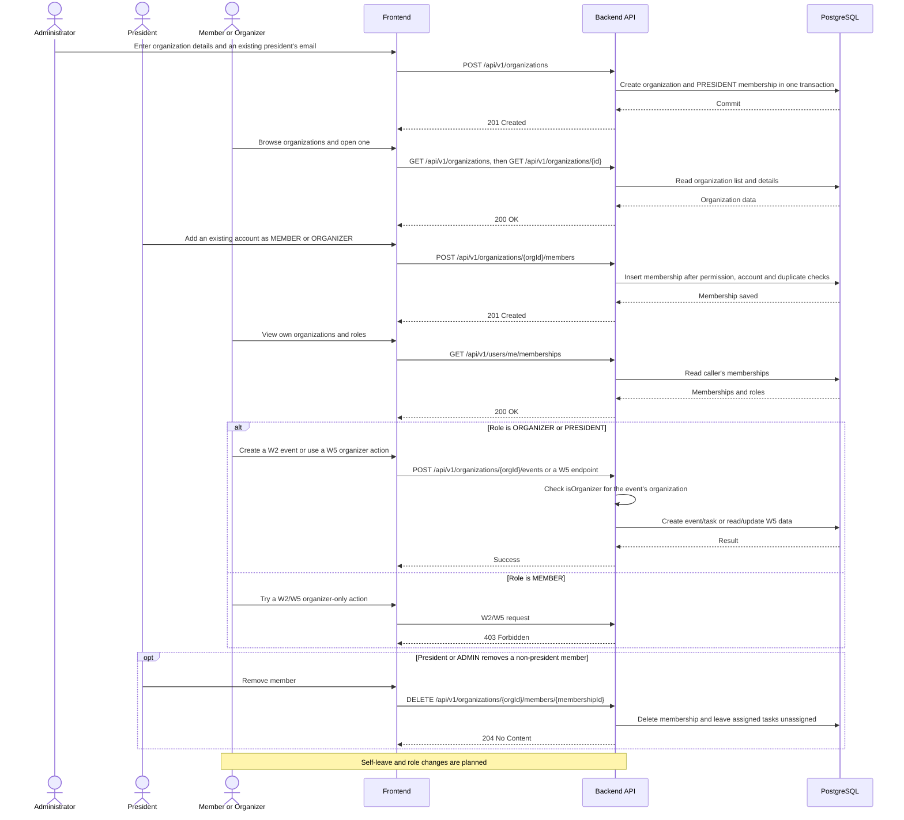
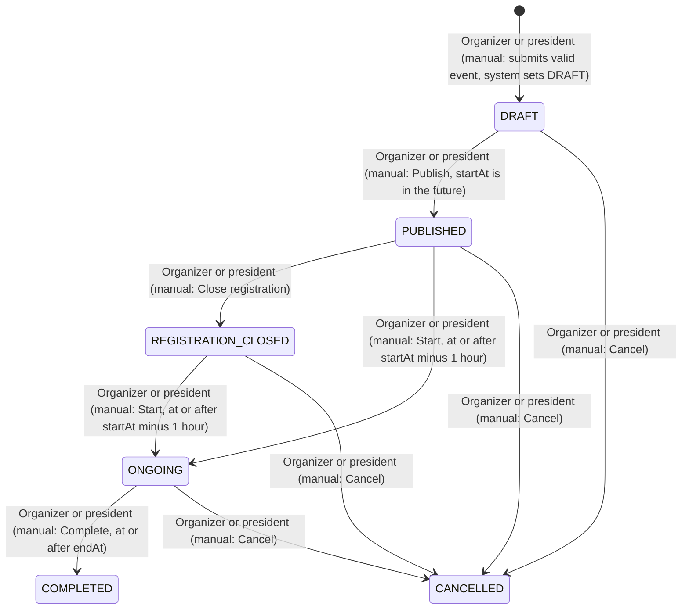
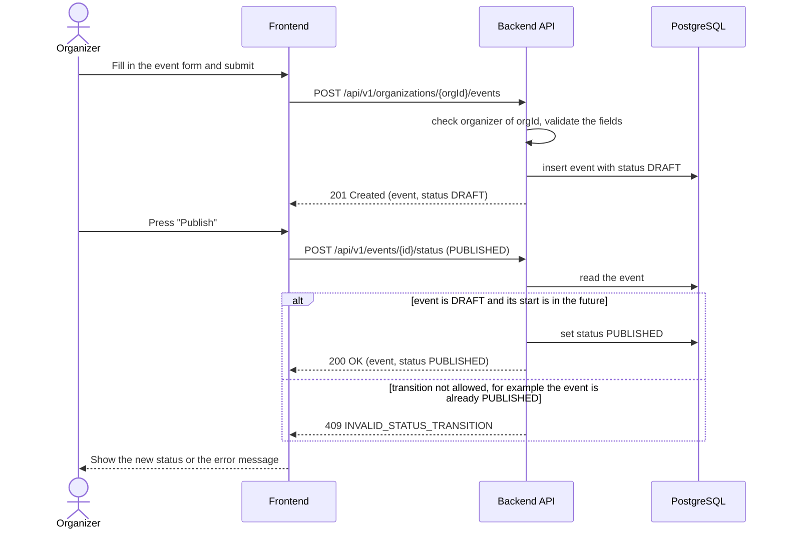
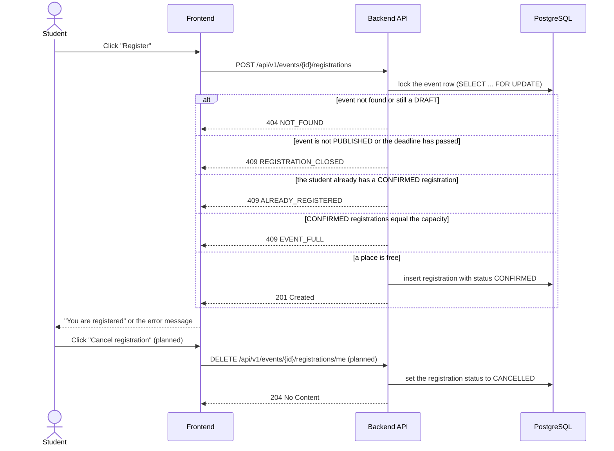

# 5. Main application workflows

Part **B.5** of the mid-term deliverable. Index: [README](README.md).

A *workflow* is the end-to-end path through the system for one goal, across UI, API and
database. Use cases (`04-use-cases.md`) describe single interactions; here you connect them.

**How to write each workflow section (same for W1–W5)**
- **Step-by-step description:** numbered steps "who does what, what the system does",
  naming the page (`frontend/src/routes/paths.ts`) and the endpoint (`/api/v1/...`, or
  "planned") at each step. 6–12 steps.
- **Diagram:** one Mermaid diagram, either `sequenceDiagram` (User → Frontend → API → DB)
  or `flowchart TD` (decisions and branches). Keep it to ~15 nodes/messages.
- **Business rules:** bullet list of the rules that apply, with their source.
- **Traceability line:** `R: … · FR: … · UC: … · Code: <packages> · Tests: <test classes or "planned">`.
- **Owner:** the teammate who owns the workflow (see `08-individual-contributions.md`).

**Common sources:** `CLAUDE.md` (workflow table, backend organization), `docs/data-model.md`,
`docs/architecture/ADR-001…`, `docs/course/course-requirements.md`, `02-requirements.md`,
`04-use-cases.md`, `06-ux-research.md` → "Main product flows".

**Format example (applies to all sections):** See the completed W1 workflow in
[§5.1](#51-w1-organizations-and-membership).

---

## 5.1 W1 Organizations and membership

**Ticket:** `docs: workflow W1` · **Points:** 2

**What to write**
From an organization being created (by an admin) to members joining, roles being assigned
and members leaving. Show how an organization role later unlocks W2/W5 actions.

**Where to find the information**
- `backend/.../organization/` (incl. `OrgPermissionService`), `frontend/src/features/organizations/`
- `docs/data-model.md` → organizations, memberships · `03-actors-roles.md`

**Format:** see top of file.

**Done when**
- [ ] Steps, diagram, business rules and traceability line are present.
- [ ] Implemented steps (list/view organizations) are distinguished from planned ones.

1. **Implemented — create:** An administrator opens **Admin** (`/admin`), enters an organization name and an existing account's email as its president, then submits. The frontend calls `POST /api/v1/organizations`.
2. **Implemented — appoint president:** The backend creates the organization and its `PRESIDENT` membership together in one transaction; the account must already exist.
3. **Implemented — list organizations:** A logged-in user opens **Organizations** (`/organizations`). The frontend calls `GET /api/v1/organizations` and displays the organizations sorted by name.
4. **Implemented — view organization:** The user opens an organization's details (`/organizations/{id}`); the frontend calls `GET /api/v1/organizations/{orgId}`. A logged-in member or an administrator can also see its members through `GET /api/v1/organizations/{orgId}/members`.
5. **Implemented — add members and assign initial roles:** The organization's president or an administrator submits an existing account's email and role (`MEMBER` or `ORGANIZER`) from the members section on `/organizations/{id}`. The frontend calls `POST /api/v1/organizations/{orgId}/members`; a student cannot join themself in the MVP.
6. **Implemented — see membership:** The added user sees the organization and their role in the app; the frontend loads `GET /api/v1/users/me/memberships`.
7. **Implemented — W2 access:** An `ORGANIZER` or `PRESIDENT` can create an event from
   `/organizing/events/new` with `POST /api/v1/organizations/{orgId}/events`; it starts as
   `DRAFT`. They can edit a DRAFT or PUBLISHED event from `/organizing/events/{id}/edit`
   with `PUT /api/v1/events/{id}`.
8. **Implemented in the backend — W5 access:** An `ORGANIZER` or `PRESIDENT` can list
   participants (`GET /api/v1/events/{eventId}/registrations`), create/list/update tasks
   (`POST /api/v1/events/{eventId}/tasks`, `GET /api/v1/events/{eventId}/tasks`,
   `PATCH /api/v1/events/{eventId}/tasks/{taskId}`), post announcements
   (`POST /api/v1/events/{eventId}/announcements`) and check in a participant
   (`POST /api/v1/events/{eventId}/registrations/{registrationId}/check-in`). The W5 web
   screens are planned; the organizing route is `/organizing/events/{id}`.
9. **Implemented — remove members; planned — leave or change role:** A president or administrator removes a non-president from `/organizations/{id}` with `DELETE /api/v1/organizations/{orgId}/members/{membershipId}`. A member leaving themself and changing a membership between `MEMBER` and `ORGANIZER` are planned; how a president leaves or is replaced is still open.

**Business rules**
- Only a global `ADMIN` can create an organization. The president is an existing account, and the organization plus its president membership are created together; organization names are unique ignoring case. (`OrganizationController`, `OrganizationService`; `docs/data-model.md`, organizations; FR-W1-03)
- Only the organization's president or a global `ADMIN` can add or remove members. New memberships can be `MEMBER` or `ORGANIZER`; the president is appointed at creation, not through the add-member endpoint. Students do not self-join in the MVP. (`OrganizationController`, `MembershipService`; FR-W1-05, FR-W1-06)
- A user has at most one membership per organization. Roles belong to a specific organization and form the hierarchy `PRESIDENT ⊃ ORGANIZER ⊃ MEMBER`; a global `ADMIN` has no automatic organization role or organizer rights. (`uq_memberships_user_organization`; `OrgPermissionService`; `docs/data-model.md`, organization_memberships)
- `ORGANIZER` and `PRESIDENT` satisfy `isOrganizer` for W2 event creation and W5 organizer endpoints; a plain `MEMBER` does not. W5 APIs exist on `main`, while their web screens are planned. An assigned task's member must belong to the event's organization. (`OrgPermissionService`, `EventController`, `TaskService`, `RegistrationService`, `AnnouncementService`; `docs/data-model.md`, service rules 3 and 5)
- The president cannot be removed. Removing another member makes tasks assigned to that membership unassigned; member self-leave and role changes are planned. (`MembershipService`; `fk_event_tasks_assignee`; FR-W1-06, FR-W1-08, FR-W1-09)

`R: R1, R2, R5 · FR: FR-ADM-02, FR-ADM-03, FR-W1-01, FR-W1-02, FR-W1-03, FR-W1-04, FR-W1-05, FR-W1-06, FR-W1-07, FR-W1-08, FR-W1-09, FR-W2-01, FR-W2-03, FR-W5-01, FR-W5-02, FR-W5-03, FR-W5-04, FR-W5-05, FR-W5-07, FR-W5-08, FR-W5-09 · UC: UC-05, UC-10, UC-11, UC-12, UC-13, UC-20, UC-21, UC-50, UC-51, UC-52, UC-53, UC-54 · Code: organization, event, organizing, registration · Tests: OrganizationCreateControllerIntegrationTest, OrganizationControllerIntegrationTest, OrganizationAddMemberControllerIntegrationTest, OrganizationRemoveMemberControllerIntegrationTest, MyMembershipsControllerIntegrationTest, OrgPermissionServiceTest, OrgPermissionPreAuthorizeIntegrationTest, EventControllerIntegrationTest, TaskControllerIntegrationTest, TaskUpdateControllerIntegrationTest, RegistrationListControllerIntegrationTest, RegistrationCheckInControllerIntegrationTest, RegistrationServiceCheckInTest, AnnouncementControllerIntegrationTest; FR-W1-08/09 planned`

---

## 5.2 W2 Event creation and lifecycle

**Ticket:** `docs: workflow W2 + event state machine` · **Points:** 3

**What to write**
From an organizer creating a draft to the event being completed or cancelled: who triggers
each transition, which checks apply (dates, required fields, permissions), and what happens
to registrations when an event is cancelled.

**Where to find the information**
- `backend/.../event/` (`Event`, `EventStatus`, `EventCategory`)
- `docs/data-model.md` → events constraints, D3, D4, D11 (optimistic locking), service rule 4

**Format:** see top of file, plus the state machine below.

### Event status state machine

**What to write**
A state diagram of `EventStatus`. The states and the allowed transitions are already
decided: copy them from the **source of truth**, do not invent new ones:
- `backend/src/main/java/ro/ubb/events/event/entity/EventStatus.java` (the states)
- `docs/data-model.md` → "Status lifecycle (W2)" (the transitions; CANCELLED reachable from any status except COMPLETED)

Label every transition with the trigger (user action or time-based) and the actor. If the
team wants to change the lifecycle, update data-model.md and the code first (via a PR),
then this diagram.

**Format:** Mermaid `stateDiagram-v2`.

**Done when**
- [x] W2 steps, diagram, business rules and traceability line are present.
- [x] All six `EventStatus` values and all allowed transitions appear, matching data-model.md.
- [x] Each transition names its trigger and actor (manual or automatic).

**Checked against the code (T-49, 2026-11-17).** The diagram was compared with
`EventStatus` (6 states), `EventLifecycle.rejectionReason` (allowed transitions and date
rules), `EventService.changeStatus` (organizer/president check, 409 on rejection), the
transition matrix in `EventLifecycleTest` and the buttons in the frontend `StatusActions`
(Publish, Close registration, Start, Complete, Cancel). All ten transitions, their
conditions and actors match; there is no automatic (time-based) transition. The only
difference was in `docs/data-model.md`, which showed a strict linear chain without
`PUBLISHED → ONGOING` and without the date conditions; it now has the same transition table.

### Sequence diagram: create a draft, publish, rejected transition

Creating a draft and changing its status are implemented on `main` (`POST /api/v1/organizations/{orgId}/events` and `POST /api/v1/events/{id}/status`). The diagram shows an allowed publish action and a rejected transition; lifecycle violations return 409 `INVALID_STATUS_TRANSITION`.

1. **Implemented — open the organizer event list:** An `ORGANIZER` or `PRESIDENT` opens **Organizing** (`/organizing`) and selects an organization. The frontend loads its events with `GET /api/v1/organizations/{orgId}/events`; organizers see drafts as well as events in other statuses.
2. **Implemented — create a draft:** From `/organizing/events/new`, the organizer submits the event form to `POST /api/v1/organizations/{orgId}/events`. The API requires a title, location, category, start and end times, and positive capacity; description and registration deadline are optional. The start must be in the future, the end after the start, and a supplied registration deadline no later than the start. The API creates the event as `DRAFT` and returns `201 Created`.
3. **Implemented — view and edit:** The organizer opens `/organizing/events/{id}` and can edit from `/organizing/events/{id}/edit` using `PUT /api/v1/events/{id}`. Only `DRAFT` and `PUBLISHED` events are editable; the request includes the last-read version, applies the creation field rules, and cannot lower capacity below confirmed registrations. A stale version returns `409 CONCURRENT_UPDATE`.
4. **Implemented — publish:** The organizer selects **Publish**, which sends `POST /api/v1/events/{id}/status` with `PUBLISHED`. Only `DRAFT → PUBLISHED` is allowed, and `startAt` must still be in the future. A successful request returns the event with status `PUBLISHED`.
5. **Implemented — close registration:** The organizer selects **Close registration** to change `PUBLISHED → REGISTRATION_CLOSED` through the same status endpoint. This transition has no additional date check.
6. **Implemented — start:** The organizer selects **Start** to change either `PUBLISHED` or `REGISTRATION_CLOSED` to `ONGOING`. The request is accepted only from one hour before `startAt` onward.
7. **Implemented — complete:** Once `endAt` has passed, the organizer selects **Complete** to change `ONGOING → COMPLETED`. The service rejects completion before the end time.
8. **Implemented — cancel:** The organizer can select **Cancel** from `DRAFT`, `PUBLISHED`, `REGISTRATION_CLOSED`, or `ONGOING`; the service changes the status to `CANCELLED`. It does not delete the event or change/delete its registration records; registrations remain as history and the event is shown as cancelled.
9. **Implemented — handle rejected actions:** Every status request checks that the caller is an `ORGANIZER` or `PRESIDENT` of the event's organization. A caller without that role receives `403 FORBIDDEN`; an unknown event returns 404; a disallowed transition or unmet lifecycle date condition returns `409 INVALID_STATUS_TRANSITION`. The frontend displays the result or error on the organizer event page.

**Business rules**
- An event is created only by an `ORGANIZER` or `PRESIDENT` of its organization and always starts as `DRAFT`; a global `ADMIN` has no event-management rights unless they also have an organizer role in that organization. (`EventController`, `EventService`, `OrgPermissionService`; FR-W2-01)
- Required fields are title (max 200 characters), location (max 255), category, `startAt`, `endAt`, and positive capacity. `startAt` must be future; `endAt > startAt`; optional `registrationDeadline <= startAt`. Description and registration deadline may be null. Invalid values return 400 `VALIDATION_FAILED`. (FR-W2-02; `EventRequest`, `EventDatesValidator`, D3, events constraints)
- Only `DRAFT` and `PUBLISHED` events can be edited. Updates carry the last-read version (D11), and capacity cannot be reduced below confirmed registrations. (FR-W2-03; `EventService.update`, D11)
- A draft is visible only to organizers of its organization; other authenticated users receive 404 when requesting it. Publishing makes it visible beyond the organizing team. (FR-W2-04; `EventService.getById`)
- The allowed transitions are `DRAFT → PUBLISHED`, `PUBLISHED → REGISTRATION_CLOSED`, `PUBLISHED → ONGOING`, `REGISTRATION_CLOSED → ONGOING`, `ONGOING → COMPLETED`, and `DRAFT | PUBLISHED | REGISTRATION_CLOSED | ONGOING → CANCELLED`. Publishing requires a future start; starting is allowed from one hour before the start; completing requires the end time to have passed. Every transition is manual—an organizer invokes the status action; no scheduler advances statuses. Any other transition, including a same-status request or a transition out of `COMPLETED` or `CANCELLED`, returns 409 `INVALID_STATUS_TRANSITION`. (FR-W2-05–10; `EventLifecycle`, `EventService.changeStatus`, data-model service rule 4)
- Cancellation retains the event row and leaves all registration records and their statuses unchanged. Events with registrations must not be hard-deleted, preserving registration history. (`EventService.changeStatus`; FR-W2-09; D4, `fk_registrations_event`)

`R: R1, R4 · FR: FR-W2-01, FR-W2-02, FR-W2-03, FR-W2-04, FR-W2-05, FR-W2-06, FR-W2-07, FR-W2-08, FR-W2-09, FR-W2-10 · UC: UC-20, UC-21, UC-22, UC-23, UC-24 · Code: event, organization, registration, frontend organizing · Tests: EventControllerIntegrationTest, EventLifecycleTest, EventRequestValidationTest`

---

## 5.3 W3 Event discovery and search

**Ticket:** `docs: workflow W3` · **Points:** 1

**What to write**
From a student opening the events page to deciding whether to register: listing, filtering,
searching, opening details. Show which events are visible (statuses) and what information
supports the decision.

**Where to find the information**
- `backend/.../event/repository/EventRepository.java`, `docs/data-model.md` → W3 indexes
- `frontend/src/features/events/` · `06-ux-research.md` (how students find events today)

**Format:** see top of file (a `flowchart TD` usually fits best).

**Done when**
- [ ] Steps, diagram, business rules and traceability line are present.
- [ ] The hand-off to W4 ("Register" button) is shown.

> TODO (team): W3 workflow here.

---

## 5.4 W4 Participant registration

**Ticket:** `docs: workflow W4` · **Points:** 2

**What to write**
Register, see my registrations, cancel and register again. Explain how the capacity limit
is guaranteed when two students register for the last place at the same time.

**Where to find the information**
- `backend/.../registration/`, `frontend/src/features/registrations/`
- `docs/data-model.md` → registrations constraints, service rules 1–2, D1 (no waitlist)

**Format:** see top of file (a `sequenceDiagram` with an `alt` block for "full" fits best).

**Done when**
- [ ] Steps, diagram, business rules and traceability line are present.
- [ ] The concurrency/capacity rule and the rejection paths are shown.

### Sequence diagram: register with a capacity check, and cancel

Registering exists on `main` (`POST /api/v1/events/{id}/registrations`). Cancelling (`DELETE /api/v1/events/{id}/registrations/me`, ticket T-22) is **planned**: the diagram shows the agreed contract. The event row is locked first, so two students taking the last place are handled one after the other (`docs/data-model.md`, rules 1 and 2).

> TODO (team): W4 workflow here.

---

## 5.5 W5 Event organization

**Ticket:** `docs: workflow W5` · **Points:** 2

**What to write**
What organizers do between publishing and completing an event: split work into tasks and
assign them, follow the participant list, post announcements, check in participants at
the door. Show how this connects to the event status (e.g. check-in while ONGOING).

**Where to find the information**
- `backend/.../organizing/` (`EventTask`, `TaskStatus`, `Announcement`), `Registration.checkedInAt`
- `docs/data-model.md` → event_tasks, announcements, service rules 3 and 5
- `frontend/src/features/organizing/` · `06-ux-research.md` (organizer interviews)

**Format:** see top of file. Optionally a small `stateDiagram-v2` for `TaskStatus`.

**Done when**
- [ ] Steps, diagram, business rules and traceability line are present.
- [ ] Tasks, announcements and check-in all appear.
- [ ] At least one step is justified by an interview finding (R5).

> TODO (team): W5 workflow here.
